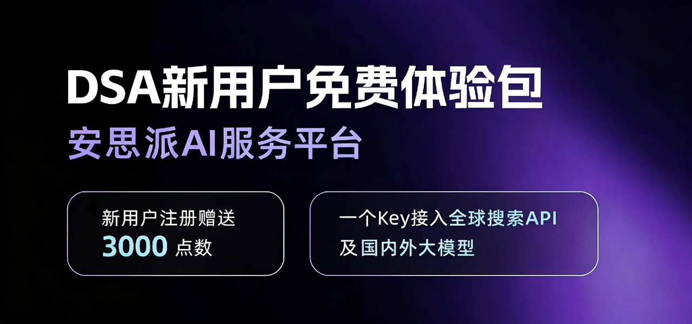
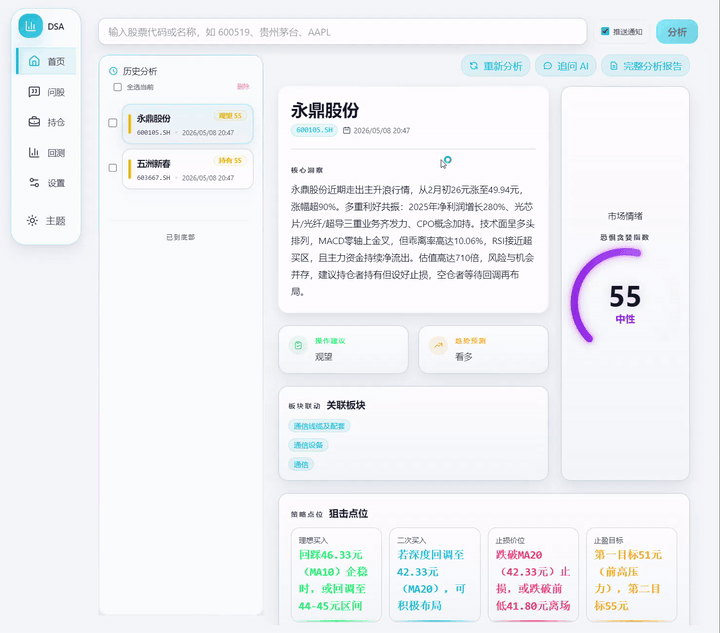

<div align="center">

# 📈 AI Stock Analysis System

[](https://github.com/ZhuLinsen/daily_stock_analysis/stargazers)
[](https://arxiv.org/abs/2608.26990)
[](https://github.com/ZhuLinsen/daily_stock_analysis/actions/workflows/ci.yml)
[](https://opensource.org/licenses/MIT)
[](https://www.python.org/downloads/)
[](https://github.com/features/actions)
[](https://hub.docker.com/r/zhulinsen/daily_stock_analysis)

<p align="center">
  &nbsp;<a href="https://hellogithub.com/repository/ZhuLinsen/daily_stock_analysis" target="_blank"></a>
</p>

> 🤖 AI-powered watchlist analysis for A-shares / Hong Kong / US / Japanese / Korean / Taiwan stocks, generating a daily "Decision Dashboard" and pushing it to WeChat Work / Feishu / Telegram / Discord / Slack / Email

[**Product Preview**](#-product-preview) · [**Key Features**](#-key-features) · [**Quick Start**](#-quick-start) · [**Sample Output**](#-sample-output) · [**Documentation Index**](docs/INDEX_EN.md) · [**Full Guide**](docs/full-guide_EN.md)

English | [简体中文](README_CH.md) | [繁體中文](docs/README_CHT.md)

</div>

## 💖 Sponsors
<div align="center">
  <p align="center">
    <a href="https://open.anspire.cn/dsa?share_code=QFBC0FYC" target="_blank"></a>
    <a href="https://serpapi.com/github-daily-stock-analysis" target="_blank"></a>
  </p>
</div>


## 🖥️ Product Preview

<p align="center">
  
</p>

## ✨ Key Features

| Capability | Coverage |
|------|------|
| AI decision reports | Core conclusions, scores, trends, entry/exit levels, risk alerts, catalysts, and an action checklist |
| Multi-market data aggregation | Covers A-shares, Hong Kong, US, Japanese, Korean, Taiwan stocks, and ETFs, with quotes, K-lines, technical indicators, news, announcements, fundamentals, and report context; per-market data sources and capability boundaries are in [Market Support Boundaries](docs/market-support.md) |
| Web / desktop workspace | Manual analysis, task progress, history reports, full Markdown reports, backtesting, portfolio, settings, and light/dark themes |
| Agent strategy chat | Multi-turn follow-ups with 15 built-in strategies such as moving averages, Chan theory, Elliott wave, trend, hot themes, events, growth, and expectations; available across Web/Bot/API |
| Smart import and autocomplete | Image, CSV/Excel, and clipboard import; autocomplete by ticker/name/pinyin/alias |
| Automation and notifications | GitHub Actions, Docker, local scheduled tasks, FastAPI service, and WeChat Work/Feishu/Telegram/Discord/Slack/email delivery |

> For feature details, field contracts, fundamental P0 timeout semantics, trading discipline, data-source priority, and Web/API behavior, see the [Full Configuration and Deployment Guide](docs/full-guide_EN.md).

### Tech Stack & Data Sources

| Type | Supported |
|------|------|
| AI models | [Anspire](https://open.anspire.cn/dsa?share_code=QFBC0FYC), [AIHubMix](https://inferera.com/?aff=CfMq), Gemini, OpenAI-compatible providers, DeepSeek, Qwen, Claude, Ollama local models, and more |
| Market data | [TickFlow](https://tickflow.org/auth/register?ref=WDSGSPS5XC), AkShare, Tushare, Pytdx, Baostock, YFinance, Longbridge |
| News search | [Anspire](https://open.anspire.cn/dsa?share_code=QFBC0FYC), [SerpAPI](https://serpapi.com/github-daily-stock-analysis), [Tavily](https://tavily.com/), [Bocha](https://open.bocha.cn/), [Brave](https://brave.com/search/api/), [MiniMax](https://platform.minimaxi.com/), SearXNG |
| Social sentiment | [Stock Sentiment API](https://api.adanos.org/docs) (Reddit / X / Polymarket, US stocks only, optional) |

> The project ships with free market-data sources such as AkShare, Baostock, and YFinance and can run with zero configuration; free sources are subject to upstream rate limits, API changes, and network volatility, so stability is not guaranteed. For long-running schedules, batch analysis, or more stable quotes, configure token-based sources such as TickFlow, Tushare, or Longbridge. Market coverage, Actions mappings, and fallback rules are described in [Data Source Configuration](docs/full-guide_EN.md#data-source-configuration).

## 🚀 Quick Start

### Option 1: [GitHub Actions (Recommended)](https://www.bilibili.com/video/BV11FEb66EXG/)

> Deploy in 5 minutes, at zero cost, with no server required.


#### 1. Fork this repository

Click the `Fork` button in the upper-right corner (a Star ⭐ is also much appreciated).

#### 2. Configure Secrets

`Settings` → `Secrets and variables` → `Actions` → `New repository secret`

**AI model configuration (configure at least one)**

Start with one model provider and its API key. For multiple models, image recognition, local models, or advanced routing, see the [LLM Configuration Guide](docs/LLM_CONFIG_GUIDE_EN.md).

| Secret Name | Description | Required |
|------------|------|:----:|
| `ANSPIRE_API_KEYS` | [Anspire](https://open.anspire.cn/dsa?share_code=QFBC0FYC) API key: one key enables both globally popular LLMs and web search; new users of this project receive free credits worth CNY 30 (special offers on GLM5.2, GPT, and more) | **Recommended** |
| `AIHUBMIX_KEY` | [AIHubMix](https://inferera.com/?aff=CfMq) API key: one key to switch among the full model lineup, with no VPN required; a 10% discount is available for this project | **Recommended** |
| `GEMINI_API_KEY` | Google Gemini API key | Optional |
| `ANTHROPIC_API_KEY` | Anthropic Claude API key | Optional |
| `OPENAI_API_KEY` | OpenAI-compatible API key (supports DeepSeek, Qwen, and more) | Optional |
| `OPENAI_BASE_URL` / `OPENAI_MODEL` | Fill these in when using an OpenAI-compatible service | Optional |

> Ollama is better suited to local / Docker deployment. GitHub Actions works best with a cloud API.

**Notification channel configuration (configure at least one)**

| Secret Name | Description |
|------------|------|
| `WECHAT_WEBHOOK_URL` | WeChat Work bot |
| `FEISHU_WEBHOOK_URL` | Feishu bot |
| `TELEGRAM_BOT_TOKEN` + `TELEGRAM_CHAT_ID` | Telegram |
| `DISCORD_WEBHOOK_URL` | Discord webhook |
| `SLACK_BOT_TOKEN` + `SLACK_CHANNEL_ID` | Slack bot |
| `EMAIL_SENDER` + `EMAIL_PASSWORD` | Email delivery |

More channels, signature verification, grouped emails, Markdown-to-image, and other settings are in [Notification Channel Configuration](docs/full-guide_EN.md#notification-channel-configuration).

**Watchlist configuration (required)**

| Secret Name | Description | Required |
|------------|------|:----:|
| `STOCK_LIST` | Watchlist ticker codes, such as `600519,hk00700,AAPL,7203.T,005930.KS,2330.TW`; registered-index explicit codes (such as `sh000016`, `930606.CSI`) are supported via the one-shot `--stocks` option or the GitHub Actions entry point — see [Index Watchlist Configuration](docs/full-guide_EN.md#index-watchlist-configuration) | ✅ |

**News source configuration (recommended)**

News sources significantly affect the quality of sentiment, announcements, events, and catalysts. We recommend configuring at least one search service.

| Secret Name | Description | Required |
|------------|------|:----:|
| `ANSPIRE_API_KEYS` | [Anspire AI Search](https://open.anspire.cn/dsa?share_code=QFBC0FYC): aggregates global sentiment data and is suited to news and sentiment search for A-shares, US stocks, Hong Kong stocks, and more; the same key can be reused for LLM services; new users of this project receive free credits worth CNY 30 | **Recommended** |
| `SERPAPI_API_KEYS` | [SerpAPI](https://serpapi.com/github-daily-stock-analysis): search-engine result enrichment, well suited to real-time financial news | **Recommended** |
| `TAVILY_API_KEYS` | [Tavily](https://tavily.com/): general-purpose news search API | Optional |
| `BOCHA_API_KEYS` | [Bocha Search](https://open.bocha.cn/): Chinese search optimization with AI summaries | Optional |
| `BRAVE_API_KEYS` | [Brave Search](https://brave.com/search/api/): privacy-first, US-stock news enrichment | Optional |
| `MINIMAX_API_KEYS` | [MiniMax](https://platform.minimaxi.com/): structured search results | Optional |
| `SEARXNG_BASE_URLS` | Self-hosted SearXNG instances: quota-free fallback, suitable for private deployments | Optional |

More search providers, social sentiment, and fallback rules are in [Search Service Configuration](docs/full-guide_EN.md#search-service-configuration).

**Market data source configuration (optional)**

> Free data sources such as AkShare, Baostock, and YFinance are used by default. "Not configured" messages in the logs are informational and do not affect execution.
> For more stable market data, configure the following secrets by market:

| Secret Name | Market | Description |
|------------|:--------:|------|
| `TUSHARE_TOKEN` | A-shares | Improves historical market-data stability |
| `LONGBRIDGE_OAUTH_CLIENT_ID` + `LONGBRIDGE_OAUTH_TOKEN_CACHE_B64` | HK/US stocks | Fills in fields such as volume ratio, turnover rate, and P/E |

> See [Data Source Configuration](docs/full-guide_EN.md#data-source-configuration).

#### 3. Enable Actions

`Actions` tab → `I understand my workflows, go ahead and enable them`

#### 4. Manual Test

`Actions` → `Daily Stock Analysis` → `Run workflow` → `Run workflow`

#### Done

By default, the workflow runs automatically at **18:00 Beijing time every weekday**, and can also be triggered manually. It does not run on non-trading days by default (including A-share/HK/US holidays); forced runs, trading-day checks, resume-from-checkpoint rules, and other details are covered in the [Full Guide](docs/full-guide_EN.md#scheduled-task-configuration).

### Option 2: [Client Setup Tutorial](https://www.bilibili.com/video/BV11FEb66Eyr/) / Local Run / Docker Deployment

```bash
# Clone the project
git clone https://github.com/ZhuLinsen/daily_stock_analysis.git && cd daily_stock_analysis

# Install dependencies
pip install -r requirements.txt

# Configure environment variables
cp .env.example .env && vim .env

# Run analysis
python main.py
```

Common commands:

```bash
python main.py --debug
python main.py --dry-run
python main.py --stocks 600519,hk00700,AAPL,2330.TW
python main.py --market-review
python main.py --schedule
python main.py --serve-only
```

> For Docker deployment, scheduled tasks, and cloud-server access, see the [Full Guide](docs/full-guide_EN.md); for desktop client packaging, see [Desktop Packaging Guide](docs/desktop-package.md).

## 📱 Sample Output

### Decision Dashboard
```
🎯 2026-02-08 Decision Dashboard
Analyzed 3 stocks | 🟢 Buy:0 🟡 Watch:2 🔴 Sell:1

📊 Analysis Summary
⚪ China Tungsten and Hightech (000657): Watch | Score 65 | Bullish
⚪ Yongding Group (600105): Watch | Score 48 | Range-bound
🟡 Kinglai Hygienic Materials (300260): Sell | Score 35 | Bearish

⚪ China Tungsten and Hightech (000657)
📰 Key Information at a Glance
💭 Sentiment: The market is focused on its AI exposure and high earnings growth, and sentiment is positive; however, short-term profit-taking and main-force outflows still need to be digested.
📊 Earnings Outlook: Based on public sentiment, the company reported strong year-over-year growth in the first three quarters of 2025, with solid fundamentals supporting the share price.

🚨 Risk Alerts:

Risk 1: On February 5, main-force funds posted a large net outflow of RMB 363 million; watch for short-term selling pressure.
Risk 2: Chip concentration is as high as 35.15%, indicating dispersed holdings and potentially strong resistance to further gains.
Risk 3: Sentiment mentions the company's historical compliance records and restructuring-related risk disclosures; keep monitoring these.
✨ Positive Catalysts:

Catalyst 1: The market sees the company as a core HDI supplier for AI servers, benefiting from the growth of the AI industry.
Catalyst 2: Non-recurring net profit surged 407.52% year over year in the first three quarters of 2025, showing strong performance.
📢 Latest Update: [Latest] Sentiment indicates the company is a leader in AI PCB micro-drills and is deeply tied to leading global PCB/substrate manufacturers. Main-force funds posted a net outflow of RMB 363 million on February 5; monitor subsequent fund flows.

---
Generated at: 18:00
```

### Market Review
```
🎯 2026-01-10 Market Review

📊 Major Indices
- SSE Composite: 3250.12 (🟢+0.85%)
- SZSE Component: 10521.36 (🟢+1.02%)
- ChiNext: 2156.78 (🟢+1.35%)

📈 Market Overview
Advancing: 3920 | Declining: 1349 | Limit up: 155 | Limit down: 3

🔥 Sector Performance
Leading: Internet Services, Media & Entertainment, Minor Metals
Lagging: Insurance, Airlines & Airports, Solar Equipment
```

## ⚙️ Configuration

For complete environment variables, model providers, notification channels, data-source priority, trading discipline, fundamental P0 semantics, and deployment instructions, see the [Full Configuration Guide](docs/full-guide_EN.md).

## 🖥️ Web UI

The Web workspace provides settings management, task monitoring, manual analysis, history reports, full Markdown reports, Agent strategy chat, backtesting, portfolio management, smart import, and light/dark themes. Start it with:

```bash
python main.py --webui
python main.py --webui-only
```

Then visit `http://127.0.0.1:8000`. For details on authentication, smart import, search autocomplete, report copying, cloud-server access, and more, see [Local WebUI Management Interface](docs/full-guide_EN.md#local-webui-management-interface).

## 🤖 Agent Strategy Chat

Once any available AI API key is configured, strategy chat is available on the Web `/chat` page; set `AGENT_MODE=false` to explicitly disable it.

- Built-in strategies include moving-average golden cross, Chan theory, Elliott wave theory, bull trend, hot themes, event-driven, growth quality, expectation repricing, and more
- Invokes realtime quotes, K-lines, technical indicators, news, and risk information
- Supports multi-turn follow-ups, session export, delivery to notification channels, and background execution
- Supports custom strategy files and multi-agent orchestration (experimental)

> Agent parameters, `skill` naming compatibility, multi-agent mode, and budget guards are covered in the [Full Guide](docs/full-guide_EN.md#local-webui-management-interface) and the [LLM Configuration Guide](docs/LLM_CONFIG_GUIDE_EN.md).

## 🧩 Related Projects

> DSA focuses on daily analysis reports; its screening implementation references AlphaSift, while AlphaEvo is used for strategy validation and evolution.

| Project | Focus |
|------|------|
| [AlphaSift](https://github.com/ZhuLinsen/alphasift) | Reference project for DSA's screening implementation |
| [AlphaEvo](https://github.com/ZhuLinsen/alphaevo) | Strategy backtesting and self-evolution, used to validate strategy rules and iteratively explore strategy parameters and combinations |

## 📬 Contact & Collaboration

<table>
  <tr>
    <td width="92" valign="top"><strong>Email</strong></td>
    <td valign="top">
      <a href="mailto:zhuls345@gmail.com">zhuls345@gmail.com</a><br>
      Project consulting, deployment support, and feature extensions
    </td>
    <td align="center" rowspan="3" valign="middle" width="148">
      <a href="http://xhslink.com/m/tU520DWCKT" target="_blank"></a><br>
      <sub>Scan to follow on Xiaohongshu</sub>
    </td>
  </tr>
  <tr>
    <td width="92" valign="top"><strong>Xiaohongshu</strong></td>
    <td valign="top"><a href="http://xhslink.com/m/tU520DWCKT">Follow us on Xiaohongshu</a></td>
  </tr>
  <tr>
    <td width="92" valign="top"><strong>Feedback</strong></td>
    <td valign="top"><a href="https://github.com/ZhuLinsen/daily_stock_analysis/issues">Submit an Issue</a></td>
  </tr>
</table>

## 📄 License

[MIT License](LICENSE) © 2026 ZhuLinsen

Attribution to this repository is appreciated when you build on or reference this project. Thank you for supporting its continued maintenance.

## ⚠️ Disclaimer

This project is intended for learning and research purposes only and does not constitute investment advice. Stock markets carry risk; invest with caution. The author is not responsible for any losses arising from the use of this project.

---
