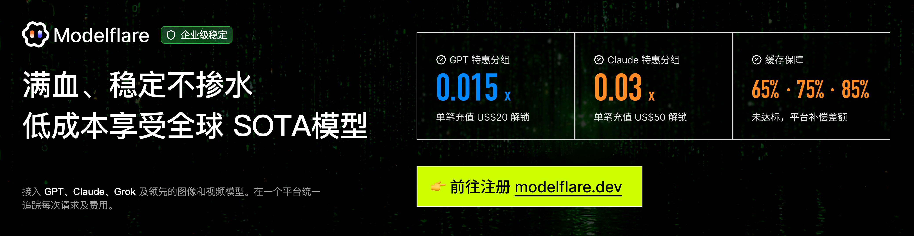
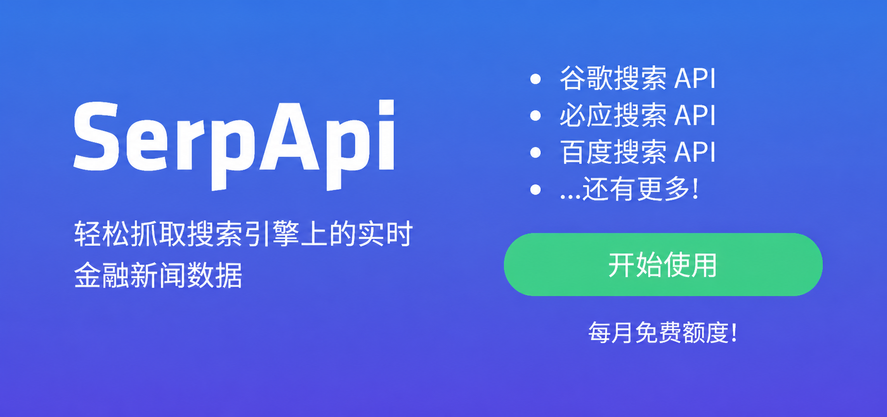

<div align="center">

# 📈 股票智能分析系统 (DSA)

[](https://github.com/ZhuLinsen/daily_stock_analysis/stargazers)
[](https://arxiv.org/abs/2608.26990)
[](https://github.com/ZhuLinsen/daily_stock_analysis/actions/workflows/ci.yml)
[](https://opensource.org/licenses/MIT)
[](https://www.python.org/downloads/)

<p align="center">
  <a href="https://trendshift.io/repositories/18527?utm_source=repository-badge&amp;utm_medium=badge&amp;utm_campaign=badge-repository-18527" target="_blank" rel="noopener noreferrer"></a>&nbsp;
  <a href="https://www.star-history.com/zhulinsen/daily_stock_analysis">
    <picture>
      <source media="(prefers-color-scheme: dark)" srcset="https://api.star-history.com/badge?repo=ZhuLinsen/daily_stock_analysis&amp;type=rank&amp;theme=dark" />
      <source media="(prefers-color-scheme: light)" srcset="https://api.star-history.com/badge?repo=ZhuLinsen/daily_stock_analysis&amp;type=rank" />
      
    </picture>
  </a>
</p>

> 🤖 覆盖 **A股 / 港股 / 美股 / 日股 / 韩股 / 台股** 的全链路 AI 投研工作台：集多源行情聚合、技术/情报分析、Agent 策略问股、决策信号回测验证、持仓风控与多渠道推送于一体

[**产品预览**](#-产品预览) · [**功能特性**](#-功能特性) · [**快速开始**](#-快速开始) · [**推送效果**](#-推送效果) · [**文档中心**](docs/INDEX.md) · [**完整指南**](docs/full-guide.md)

**[下载桌面客户端](https://github.com/ZhuLinsen/daily_stock_analysis/releases) · [5 分钟 GitHub Actions](#方式一github-actions推荐) · [Docker / 本地部署](#方式二客户端配置教程--本地运行--docker-部署)**

简体中文 | [English](docs/README_EN.md) | [繁體中文](docs/README_CHT.md)

</div>

<details>
<summary><strong>💖 赞助商 (Sponsors)：Modelflare · x6.ai · SerpAPI（点击展开优惠与注册链接）</strong></summary>
<table>
  <tr><td align="center"><a href="https://modelflare.dev/sign-up?utm_source=github&amp;utm_campaign=daily_stock_analysis"></a><br>感谢 <strong>Modelflare</strong> 赞助本项目！由美国 Havenbyte LLC 运营，满血稳定不掺水，低成本接入 GPT、Claude、Gemini、Grok 及 40+ 图片/视频模型。指定 OpenAI 分组提供 <strong>65% / 75% / 85% 每日缓存命中率保障</strong>；单笔充值 <strong>US$20 解锁 GPT 0.015x</strong>，<strong>US$50 解锁 Claude 0.03x</strong>。<a href="https://modelflare.dev/sign-up?utm_source=github&amp;utm_campaign=daily_stock_analysis">专属链接注册</a></td></tr>
  <tr><td align="center"><a href="https://console.x6pro.io/register?code=zJ2qSdns"></a><br>100+ 模型 $5 包月，Claude 1.9 折、GPT 0.9 折、DeepSeek 5.8 折，首充立减 20%。<a href="https://console.x6pro.io/register?code=zJ2qSdns">专属链接注册</a></td></tr>
  <tr><td align="center"><a href="https://serpapi.com/github-daily-stock-analysis" target="_blank"></a></td></tr>
</table>
</details>

## 🖥️ 产品预览

<p align="center">
  <a href="docs/assets/readme_workspace_tour_20260510.gif"></a><br>
  <sub>点击动图查看完整工作台演示（包含分析、选股、决策信号、持仓风控、回测与 Agent 问股）</sub>
</p>

> [!TIP]
> 🚀 **作者配套开源项目**：[AlphaSift · 智能选股](https://github.com/ZhuLinsen/alphasift) ｜ [AlphaEvo · 策略回测与进化](https://github.com/ZhuLinsen/alphaevo)

## ✨ 功能特性

| 阶段 | 核心能力与 Web 工作台模块 | 专题文档 |
|------|------|------|
| **发现** | 多因子与自然语言智能选股（`/screening`）、市场热点雷达、规则化 ETF 双动量轮动（`--etf-rotation`） | [选股引擎](docs/screening-engine.md) · [ETF 轮动](docs/etf-rotation.md) |
| **分析** | 多市场「决策仪表盘」报告（`/`）、六市场大盘复盘、15 种内置策略的多轮 Agent 策略问股（`/chat`） | [完整指南](docs/full-guide.md) · [市场边界](docs/market-support.md) |
| **验证** | 决策信号后验跟踪池（`/decision-signals`）、多窗口历史回测（`/backtest`）与 LLM Token 用量审计（`/usage`） | [决策信号](docs/decision-signals.md) · [回测配置](docs/full-guide.md#回测功能) |
| **跟踪** | 持仓风险暴露与富途同步（`/portfolio`）、EventMonitor 实时异动告警（`/alerts`）、数据源能力诊断中心（`/data`） | [持仓风控](docs/portfolio-risk-exposure-dashboard.md) · [告警中心](docs/alerts.md) · [数据中心](docs/data-center-diagnostics.md) |
| **触达与集成** | 可视化设置中心（`/settings`）、企业微信/飞书/TG/Discord/Slack/邮件推送、长图分享海报、交互 Bot、REST API 与外部 Agent Skill | [通知配置](docs/notifications.md) · [Bot 接入](docs/bot-command.md) · [OpenClaw Skill](docs/openclaw-skill-integration.md) |

> 项目默认内置 AkShare、Baostock、YFinance 等免费行情源，可零配置运行；如需更稳定的 A股/ETF/港美股行情或新闻检索，推荐配置 [TickPlus](http://www.tickplus.org/register?reg=5433cf922395)、Tushare、Longbridge 或 [SerpAPI](https://serpapi.com/github-daily-stock-analysis)，详见 [数据源稳定性指南](docs/data-source-stability.md)。

## 🚀 快速开始

| 上手方式 | 适合人群 | 所需前置 | 入口 |
|------|------|------|------|
| **桌面客户端** | 不想折腾命令行的个人投资者 | 1 个 AI API Key | [Releases 下载](https://github.com/ZhuLinsen/daily_stock_analysis/releases) · [小白教程](docs/beginner-client-setup.md) |
| **GitHub Actions** | 零服务器每日自动分析（推荐） | **仅 1 个 AI 模型 Secret** | [下方 4 步配置](#方式一github-actions推荐) |
| **Docker / 本地 WebUI** | 私有部署、持仓管理与 Agent 问股 | Docker 或 Python 3.10+ | [下方部署命令](#方式二客户端配置教程--本地运行--docker-部署) · [部署指南](docs/DEPLOY.md) |

### 方式一：[GitHub Actions（推荐）](https://www.bilibili.com/video/BV11FEb66EXG/)

> 5 分钟零成本部署：首次跑通**仅需配置 1 个 AI 模型 Secret**；`STOCK_LIST` 默认兜底 `600519`，通知渠道可选（未配通知也可在 Actions Summary 查看运行状态，或通过 `STEP_SUMMARY_REPORT=true` 开启报告预览）。

1. **Fork 本仓库**：点击右上角 `Fork`（顺便点个 Star ⭐ 支持一下）。
2. **配置至少 1 个 AI 模型 Secret**（`Settings` → `Secrets and variables` → `Actions` → `New repository secret`）：
   - **推荐渠道**：`MODELFLARE_KEY`（[Modelflare](https://modelflare.dev/sign-up?utm_source=github&utm_campaign=daily_stock_analysis)）或 `LLM_X6AI_API_KEY`（[x6.ai](https://console.x6pro.io/register?code=zJ2qSdns)）
   - **官方直连**：`GEMINI_API_KEY`、`ANTHROPIC_API_KEY`、`OPENAI_API_KEY`（兼容 DeepSeek/通义等）、`AIHUBMIX_KEY`
   - **可选增强**：`STOCK_LIST`（如 `600519,hk00700,AAPL,7203.T,005930.KS,2330.TW`，详见 [指数自选股配置](docs/full-guide.md#指数自选股配置)）、`SERPAPI_API_KEYS`（新闻补强）、`TICKPLUS_API_KEY`（A股/ETF行情）、通知渠道如 `WECHAT_WEBHOOK_URL` / `FEISHU_WEBHOOK_URL` / `TELEGRAM_BOT_TOKEN`+`TELEGRAM_CHAT_ID`（更多见 [完整配置与部署指南](docs/full-guide.md)）。
3. **启用 Workflows**：进入 Fork 仓库的 `Actions` 标签 → 点击 `I understand my workflows, go ahead and enable them`。
4. **手动测试**：`Actions` → `每日股票分析` → `Run workflow`，之后每个工作日 **18:00（北京时间）** 自动执行（非交易日默认跳过，规则见 [定时任务配置](docs/full-guide.md#定时任务配置)）。

### 方式二：[客户端配置教程](https://www.bilibili.com/video/BV11FEb66Eyr/) / 本地运行 / Docker 部署

```bash
# 1. 浅克隆代码（跳过历史包袱，更快）
git clone --depth 1 https://github.com/ZhuLinsen/daily_stock_analysis.git && cd daily_stock_analysis

# 2. 安装依赖并启动 Web 工作台（推荐直接在网页设置页配置模型与自选股）
pip install -r requirements.txt
python main.py --webui-only
```

启动后访问 `http://127.0.0.1:8000`（如改用命令行 `.env` 方式，可先执行 `cp .env.example .env` 后运行 `python main.py --doctor` 自检）。常用 CLI 模式：

```bash
python main.py --doctor                     # 全链路脱敏自检（支持 --json）
python main.py --stocks 600519,hk00700,AAPL # 一次性分析指定标的
python main.py --market-review              # 仅运行大盘复盘
python main.py --schedule                   # 本地定时调度
python main.py --serve-only                 # 仅启动 FastAPI + WebUI 服务
```

> Docker 预构建镜像、`--etf-rotation` 轮动与云服务器访问见 [完整配置与部署指南](docs/full-guide.md)；桌面端打包见 [桌面端打包说明](docs/desktop-package.md)；Agent 参数与多模型配置见 [LLM 配置指南](docs/LLM_CONFIG_GUIDE.md)。

## 📱 推送效果

<details>
<summary>点击查看文本推送示例（决策仪表盘 &amp; 大盘复盘）</summary>

### 决策仪表盘
```
🎯 2026-02-08 决策仪表盘
共分析3只股票 | 🟢买入:0 🟡观望:2 🔴卖出:1

📊 分析结果摘要
⚪ 中钨高新(000657): 观望 | 评分 65 | 看多
⚪ 永鼎股份(600105): 观望 | 评分 48 | 震荡
🟡 新莱应材(300260): 卖出 | 评分 35 | 看空

🚨 风险警报:
风险点1：主力资金大幅净卖出，需警惕短期抛压。
✨ 利好催化:
利好1：核心产品放量与业绩同比增长支撑基本面。
```

### 大盘复盘
```
🎯 2026-01-10 大盘复盘
📊 主要指数: 上证指数 3250.12 (🟢+0.85%) | 深证成指 10521.36 (🟢+1.02%) | 创业板指 2156.78 (🟢+1.35%)
📈 市场概况: 上涨 3920 | 下跌 1349 | 涨停 155 | 跌停 3
🔥 板块表现: 领涨 互联网服务、文化传媒 ｜ 领跌 保险、光伏设备
```

</details>

## 🛠️ 排障与保持更新

- **本地一键排障**：运行 `python main.py --doctor` 检查配置/LLM/通知/存储状态；提交 Issue 前请优先升级并附带脱敏诊断输出。
- **Fork 保持更新**：定期在 GitHub 页面点击 `Sync fork` 同步最新数据源修复；尽量通过 Secrets/Variables 调整参数，避免直接修改 workflow 文件产生冲突。
- **Actions 定时停用**：GitHub 会在仓库 **60 天无新提交** 后自动暂停定时任务，记得定期 Sync fork 或在 Actions 页面重新启用，详见 [FAQ](docs/FAQ.md)。

## 📬 联系与合作

<table>
  <tr>
    <td width="92" valign="top"><strong>合作邮箱</strong></td>
    <td valign="top"><a href="mailto:zhuls345@gmail.com">zhuls345@gmail.com</a>（项目咨询、部署支持与功能扩展）</td>
    <td align="center" rowspan="3" valign="middle" width="148">
      <a href="http://xhslink.com/m/tU520DWCKT" target="_blank"></a><br>
      <sub>扫码关注小红书</sub>
    </td>
  </tr>
  <tr>
    <td width="92" valign="top"><strong>小红书</strong></td>
    <td valign="top"><a href="http://xhslink.com/m/tU520DWCKT">欢迎关注小红书</a></td>
  </tr>
  <tr>
    <td width="92" valign="top"><strong>问题反馈</strong></td>
    <td valign="top"><a href="https://github.com/ZhuLinsen/daily_stock_analysis/issues">提交 Issue</a> · <a href="docs/INDEX.md">文档中心</a></td>
  </tr>
</table>

## 📄 License & ⚠️ 免责声明

[MIT License](LICENSE) © 2026 ZhuLinsen — 欢迎在二次开发或引用时注明本仓库来源。本项目仅供学习和研究使用，不构成任何投资建议；股市有风险，投资需谨慎。
