# DSA Architecture & Operations Deep Dive

This document is the detailed companion to [`README.md`](./README.md). It explains how the
Daily Stock Analysis (DSA) system is put together: entry points, runtime modes, the end-to-end
analysis pipeline, data-source failover, LLM routing, the agent subsystem, report and
notification delivery, persistence, APIs, the scheduler, configuration management, the Web and
desktop clients, and CI/CD.

It is written for people who want to **understand, extend, or operate** the project rather than
just run it. High-level product positioning stays in [`README.md`](./README.md); step-by-step
configuration guides remain in [`docs/`](./docs/).

> Conventions used below:
> - Paths are relative to the repository root.
> - “LLM analysis” means the main stock-analysis LLM call; “agent mode” means the tool-using
>   agent loop.
> - Environment-variable names are shown in `UPPER_SNAKE_CASE`. The main runtime template is
>   [`.env.example`](./.env.example), and the settings-help maintenance rules are documented in
>   [`docs/settings-help.md`](./docs/settings-help.md).
> - Mermaid diagrams are intentionally conceptual. Where a diagram says “parallel”, the code
>   uses a `ThreadPoolExecutor`.

---

## Table of contents

1. [System overview](#1-system-overview)
2. [Repository map](#2-repository-map)
3. [Runtime modes and startup](#3-runtime-modes-and-startup)
4. [End-to-end data flow](#4-end-to-end-data-flow)
5. [Market data acquisition](#5-market-data-acquisition)
6. [Analysis and LLM routing](#6-analysis-and-llm-routing)
7. [Agent subsystem](#7-agent-subsystem)
8. [Reports and notifications](#8-reports-and-notifications)
9. [Persistence layer](#9-persistence-layer)
10. [HTTP API, task queue, and authentication](#10-http-api-task-queue-and-authentication)
11. [Web UI, desktop app, and bots](#11-web-ui-desktop-app-and-bots)
12. [Scheduling](#12-scheduling)
13. [Configuration and settings](#13-configuration-and-settings)
14. [Adjacent features](#14-adjacent-features)
15. [Deployment and CI/CD](#15-deployment-and-cicd)
16. [Extension recipes](#16-extension-recipes)
17. [Troubleshooting and glossary](#17-troubleshooting-and-glossary)
18. [Source map](#18-source-map)

---

## 1. System overview

DSA is a Python 3.10+ application that turns market data, news, fundamentals, and technical
indicators into an LLM-generated decision dashboard, then delivers that report through one or
more notification channels. It supports A-shares, Hong Kong, US, Japan, Korea, Taiwan, and
exchange-traded funds (ETFs), with explicit support for market indices.

The core product loop is:

```text
market data + realtime quote + fundamentals + technical indicators
        + multi-dimension news search + persisted intelligence
        + optional social sentiment
        -> LLM analysis or tool-using agent
        -> decision dashboard / Markdown report
        -> local report file + SQLite history + notification channels + Web UI
```

### 1.1 Design principles visible in the code

| Principle | How it shows up |
| --- | --- |
| Fail-open by default | A single provider, search engine, notification channel, or optional feature failing must not abort the whole run. Per-stock failures are collected and reported without killing the batch. |
| Explicit capability routing | Daily bars, realtime quotes, chips, capital flow, and fundamentals have separate provider chains and market support matrices. |
| Configuration over code forks | Providers, models, channels, schedules, and agent behavior are driven by `.env` and YAML, not per-environment branches. |
| Deterministic fallbacks | Provider priority, circuit breakers, model fallback, notification routing, and rule-based backtesting have defined degradation paths. |
| Durable evidence | Analysis history, raw LLM output, news, fundamentals, usage telemetry, task flow events, and decision outcomes are persisted for audit and later evaluation. |
| Multiple front ends, one backend | CLI, FastAPI/Web, Electron desktop, and chat bots all converge on the same analysis services. |

### 1.2 System context

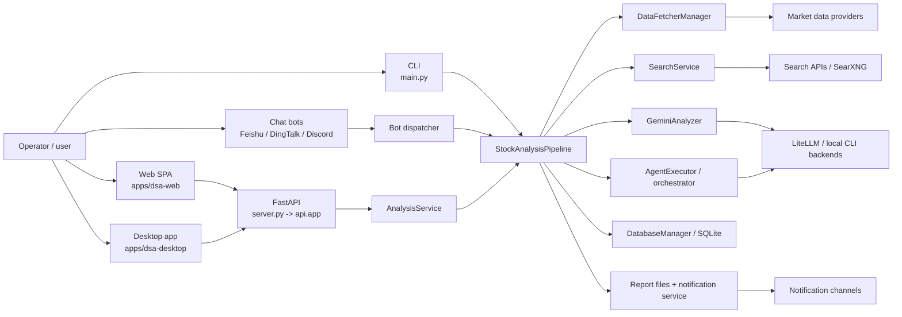

### 1.3 What is deliberately not in the hot path

- The Web UI is a static build. FastAPI serves `static/` and API routes; the browser does not
  need a Node process at runtime.
- The default aggregate report is generated without a second LLM call; it renders the results
  already produced by per-stock analysis.
- Rule-based ETF rotation and rule-based alerts do not call an LLM.
- Market review can run independently from stock analysis, and both share a process-level lock
  to avoid overlapping runs.

---

## 2. Repository map

```text
.
├── main.py                     # CLI entry point and runtime-mode dispatch
├── server.py                   # uvicorn wrapper for api.app
├── webui.py                    # compatibility shim for the Web UI entry
├── requirements.txt
├── .env.example                # Full configuration template
├── AGENTS.md                   # Repository collaboration rules
├── strategies/                 # YAML agent strategies (15 files)
├── api/
│   ├── app.py                  # FastAPI factory, middleware, SPA serving
│   ├── deps.py
│   ├── middlewares/            # Auth and error handling
│   └── v1/
│       ├── router.py           # /api/v1 router aggregation
│       ├── endpoints/          # auth, agent, analysis, history, ...
│       └── schemas/            # Pydantic request/response models
├── bot/                        # Feishu / DingTalk / Discord integrations
├── data_provider/              # Provider adapters, normalization, failover
├── src/
│   ├── core/                   # Pipeline, market review, ETF engine, locks
│   ├── services/               # Business services (analysis, tasks, screening, ...)
│   ├── repositories/           # Data access helpers
│   ├── schemas/                # Internal schemas
│   ├── agent/                  # Agent executor, tools, skills, multi-agent system
│   ├── notification_sender/    # One module per notification channel
│   ├── config.py               # Config singleton and loaders
│   ├── storage.py              # SQLAlchemy models + DatabaseManager
│   ├── analyzer.py             # LLM analysis, prompt construction, JSON parsing
│   ├── search_service.py       # Search providers and multi-dimension intel
│   ├── notification.py         # Notification orchestration and report delivery
│   ├── market_*.py             # Market phase, structure, review helpers
│   └── scheduler.py            # CLI scheduler
├── apps/
│   ├── dsa-web/                # React + TypeScript + Vite SPA
│   └── dsa-desktop/            # Electron shell around the packaged backend
├── docker/                     # Dockerfile, compose file, entrypoint
├── scripts/                    # CI gate, release, desktop packaging, utilities
├── tests/                      # pytest suite (offline markers + network tests)
├── docs/                       # Detailed guides and subsystem documentation
├── data/                       # Runtime SQLite DB and caches (not committed)
├── logs/                       # Runtime logs
├── reports/                    # Generated Markdown reports
└── static/                     # Built Web assets served by FastAPI
```

### 2.1 Module responsibility summary

| Layer | Main modules | Responsibility |
| --- | --- | --- |
| Entry / orchestration | `main.py`, `src/core/pipeline.py`, `src/services/analysis_service.py` | Mode dispatch, batch orchestration, per-stock pipeline |
| Configuration | `src/config.py`, `src/core/config_registry.py`, `src/core/config_manager.py`, `src/services/system_config_service.py` | Load, validate, expose, persist, hot-reload settings |
| Data acquisition | `data_provider/` | Provider registry, normalization, failover, circuit breakers, caches |
| Intelligence | `src/search_service.py`, `src/services/intelligence_service.py`, `src/services/social_sentiment_service.py` | Search dimensions, persisted sources, social sentiment |
| Analysis | `src/analyzer.py`, `src/market_phase_prompt.py`, `src/analysis_context_pack_prompt.py`, `src/agent/` | LLM JSON analysis, agent tool loop, strategy evaluation |
| Reporting | `src/notification.py`, `src/services/report_renderer.py`, `src/formatters.py`, `src/md2img.py` | Markdown/HTML/plain rendering, chunking, image conversion |
| Persistence | `src/storage.py`, `src/repositories/` | SQLAlchemy schema, migrations, history, telemetry |
| API | `api/` | FastAPI app, auth middleware, HTTP endpoints, SSE |
| Clients | `apps/dsa-web/`, `apps/dsa-desktop/`, `bot/` | Browser UI, desktop shell, chat interfaces |
| Scheduling | `src/scheduler.py`, `src/services/runtime_scheduler.py` | Time-based runs, ownership, watchdog, occurrence claims |
| Deployment | `docker/`, `.github/workflows/`, `scripts/` | Image builds, releases, packaging, CI gates |

### 2.2 Approximate code size

The backend is concentrated in a few large modules. This is useful to know before editing:

| File | Approx. lines | Nature |
| --- | ---: | --- |
| `src/analyzer.py` | 5,730 | Prompt construction, LLM routing, JSON parsing, localization |
| `src/search_service.py` | 4,961 | Seven search providers and dimension-specific queries |
| `src/core/pipeline.py` | 4,377 | The per-stock and batch orchestration hub |
| `src/storage.py` | 4,372 | 32 SQLAlchemy models plus migrations and queries |
| `src/config.py` | 3,860 | Dataclass config, env parsing, validation |
| `src/notification.py` | 3,115 | Channel orchestration, report saving, diagnostics |
| `main.py` | 1,947 | CLI and all runtime-mode branching |
| `src/services/task_queue.py` | 1,107 | In-memory queue, thread pool, SSE event bus |
| `src/agent/executor.py` | 916 | ReAct-style tool loop and chat persistence |
| `api/app.py` | 565 | App factory, middleware, static serving |

---

## 3. Runtime modes and startup

### 3.1 Entry points

| Entry | Purpose | Typical command |
| --- | --- | --- |
| `main.py` | CLI, one-shot analysis, scheduling, backtest, ETF rotation, Web server | `python main.py` |
| `server.py` | Uvicorn wrapper with reload | `python server.py` or `uvicorn server:app` |
| `webui.py` | Compatibility entry for the Web UI | `python webui.py` |
| Desktop executable | Spawns the packaged Python backend on a free port | `npm run dev` in `apps/dsa-desktop` |

`main.py` performs `setup_env()` at import time, optionally configures an HTTP proxy when
`USE_PROXY=true`, and supports a packaged-import probe via `DSA_PACKAGED_IMPORT_PROBE` for the
desktop build.

### 3.2 CLI flags

| Flag | Meaning |
| --- | --- |
| `--debug` | Debug logging and more verbose runtime diagnostics |
| `--dry-run` | Fetch and prepare data without calling the LLM |
| `--stocks CODE,...` | Explicit analysis targets, overriding `STOCK_LIST` |
| `--portfolio futu` | Resolve the analysis list from the Futu OpenD portfolio |
| `--no-notify` | Suppress notification delivery |
| `--check-notify` | Run channel diagnostics and exit |
| `--single-notify` | Send one notification per stock instead of an aggregate |
| `--workers N` | Override analysis concurrency (`MAX_WORKERS`) |
| `--schedule` | Enable schedule mode |
| `--no-run-immediately` | Do not run once at startup in schedule mode |
| `--market-review` / `--no-market-review` | Force or suppress market review |
| `--force-run` | Ignore the trading-day gate |
| `--webui` / `--webui-only` | Aliases for `--serve` / `--serve-only` |
| `--serve` | Start FastAPI, optionally also run a CLI schedule |
| `--serve-only` | Start the API/Web server and do not run analysis |
| `--host`, `--port` | Bind address for the Web server |
| `--no-context-snapshot` | Do not persist the analysis context snapshot |
| `--backtest` | Run historical analysis backtesting |
| `--backtest-code CODE` | Limit backtesting to one stock |
| `--backtest-days N` | Evaluation window in trading days |
| `--backtest-force` | Re-evaluate already evaluated records |
| `--etf-rotation` | Run the rule-based ETF dual-momentum rotation |

### 3.3 Startup and mode dispatch

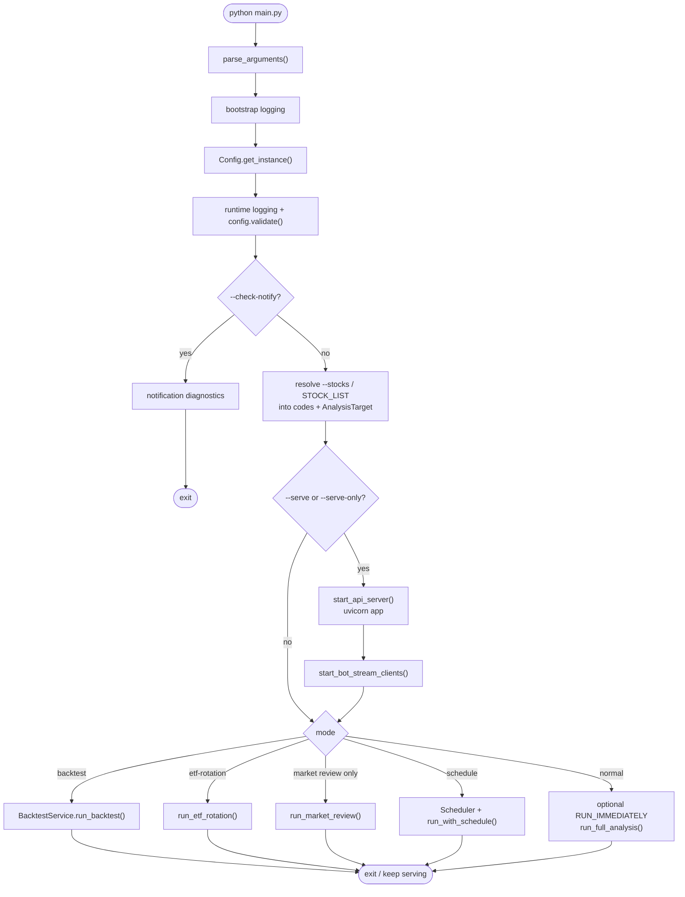

Important details:

- `--serve` and `--serve-only` are mutually exclusive in effect: `--serve-only` returns from
  `main()` after starting the server, while `--serve` continues into the selected analysis mode.
- When serving, the API runtime scheduler owns schedules. `main.py` sets
  `RUNTIME_SCHEDULER_*` environment variables and clears the CLI-owner flag so the scheduler
  shown in Web settings is the one actually running.
- When not serving, schedule mode uses `src/scheduler.py` and runs the same analysis entry in a
  loop.
- For GitHub Actions, the workflow runs `python main.py` without CLI stock flags; the code then
  classifies `STOCK_LIST` into structured `AnalysisTarget` objects.

### 3.4 `run_full_analysis()` sequence

`run_full_analysis()` in `main.py` is the one-shot CLI orchestration layer:

1. Resolve `--portfolio futu` into stock codes when requested.
2. Refresh the stock-index cache and the watchlist from `.env` (unless a scheduled snapshot or
   explicit list takes precedence).
3. Compute the per-market trading-day filter. If no configured market is open, skip the run
   unless `--force-run` is set.
4. Decide whether stock and market-review notifications should be merged.
5. Create one `StockAnalysisPipeline` with a shared `query_id`, `query_source="cli"`, and a
   frozen analysis reference time.
6. Prime the daily market context once when enabled, reusing historical summaries where
   possible.
7. Run `pipeline.run(...)` for all stocks.
8. Run `run_market_review(...)` under the shared market-review lock, or reuse the primed daily
   market context.
9. Save reports and send a merged notification when merging is configured.
10. Create a Feishu cloud document when Feishu document credentials are configured.
11. Run the automatic backtest as a post-step.

### 3.5 CLI scheduler vs API runtime scheduler

There are two scheduler implementations:

| Scheduler | Used when | Characteristics |
| --- | --- | --- |
| `src/scheduler.py` (`Scheduler`) | CLI schedule mode without `--serve` | Uses the `schedule` library, dynamic time providers, graceful shutdown |
| `src/services/runtime_scheduler.py` | API/Web/Desktop process owns the schedule | Runs analysis in a subprocess with a watchdog, exposes status and run-now via API |

Ownership is negotiated through environment flags:

- `DSA_RUNTIME_SCHEDULER_FORCE_ENABLED`
- `DSA_RUNTIME_SCHEDULER_RUN_IMMEDIATELY`
- `DSA_RUNTIME_SCHEDULER_SUPPRESS_START`
- `DSA_RUNTIME_SCHEDULER_ARGS`
- `DSA_CLI_SCHEDULER_OWNS_SCHEDULE`

This prevents two processes from both believing they own the same `SCHEDULE_TIMES` entry.

---

## 4. End-to-end data flow

### 4.1 The per-stock pipeline

`StockAnalysisPipeline.process_single_stock()` is the unit of work used by CLI batches, API
tasks, bots, and scheduled runs. `analyze_stock()` contains the substantive stages.

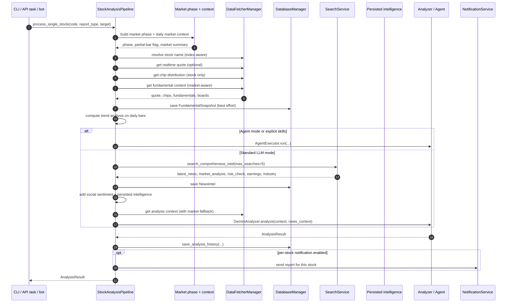

### 4.2 Stage-by-stage behavior

| Stage | Code path | What happens | Failure behavior |
| --- | --- | --- | --- |
| Target resolution | `parse_analysis_target`, `resolve_index_stock_code_for_analysis` | Detect stock vs registered index vs unsupported target; preserve canonical index identity | Unsupported targets are rejected before provider calls |
| Trading-date resolution | `fetch_and_save_stock_data`, market phase helpers | Determine the target trading date for the stock's market, including partial intraday bars | Falls back to the latest completed session |
| Data reuse | `has_today_data` | Resume from persisted daily bars when the current target date is already stored | Falls through to provider fetch |
| Daily bars | `fetcher_manager.get_daily_data(code, days=30)` | Multi-provider fetch, normalize columns, calculate MA/volume indicators | Provider chain fails over; non-index raises after all fail |
| Name resolution | `get_stock_name` / index name chain | Prefer index display names for index targets | Falls back to static maps or a generic label |
| Realtime quote | `get_realtime_quote` | Optional quote for price/change/volume-ratio enrichment | `None`; analysis proceeds on historical bars |
| Chips | `get_chip_distribution` | CN stock chip distribution; skipped for indices | Optional; missing data lowers confidence |
| Fundamentals | `get_fundamental_context` | Aggregates valuation, growth, profitability, capital flow, industry and board context | Bounded timeouts; partial context is allowed |
| Technical trend | `StockTrendAnalyzer` | MA alignment, trend phase, support/resistance, volume analysis | Trend fallback may be computed after agent output |
| Agent mode | `_analyze_with_agent` | Tool-using analysis with pre-fetched context and skill routing | Falls back to regular analysis when not enabled |
| News / intel | `search_comprehensive_intel` | Up to five dimensions; foreign vs domestic query branches | Empty result is represented explicitly (`news_result_count`) |
| Social sentiment | `SocialSentimentService` | US-market Reddit/X/Polymarket context when configured | Skipped silently when no API key |
| Persisted intel | `intelligence_items` | Previously fetched intelligence scoped by stock/market | Optional context only |
| Analysis context | `_get_analysis_context_with_market_fallback` | Merge daily bars, realtime, chips, trend, fundamentals into prompt context | Market fallback if the primary context is empty |
| LLM call | `GeminiAnalyzer.analyze` | Prompt, model routing, JSON validation, integrity retry | Returns a localized failure result rather than raising |
| Persistence | `save_analysis_history` | Stores raw result, summary, context snapshot, report type | Logged; the analysis result is still returned |
| Notification | `NotificationService` | Per-stock or aggregate delivery with routing/noise controls | Per-channel safe send; partial failure is reported |

### 4.3 Batch orchestration

`StockAnalysisPipeline.run()`:

1. Refreshes the watchlist when no explicit list is supplied.
2. Filters unsupported targets and deduplicates by canonical identity.
3. Freezes one reference time for the whole batch.
4. For five or more stocks, prefetches 30-day daily bars and realtime quotes, and prefetches
   names.
5. Reads `single_stock_notify`, `report_type`, and `analysis_delay`.
6. Runs `process_single_stock()` in a `ThreadPoolExecutor(max_workers=MAX_WORKERS)`.
7. Sends per-stock notifications serially during result collection when enabled.
8. Saves an aggregate report locally and sends the aggregate notification unless single-stock
   mode or merge mode is active.

```mermaid
flowchart LR
    Run["pipeline.run(codes)"] --> Filter["filter unsupported<br/>+ dedupe canonical IDs"]
    Filter --> Freeze["freeze reference time"]
    Freeze --> Prefetch{"len(codes) >= 5?"}
    Prefetch -->|yes| Batch["prefetch daily bars,<br/>realtime quotes, names"]
    Prefetch -->|no| Pool
    Batch --> Pool["ThreadPoolExecutor<br/>MAX_WORKERS"]
    Pool --> Workers["process_single_stock() x N"]
    Workers --> Collect["collect successes + errors"]
    Collect --> Single{"single_stock_notify?"}
    Single -->|yes| PerStock["send per-stock notifications"]
    Single -->|no| Aggregate
    PerStock --> Aggregate["generate aggregate report"]
    Aggregate --> Save["save report file"]
    Save --> Notify{"merge_notification?"}
    Notify -->|no| Send["send aggregate notification"]
    Notify -->|yes| Defer["defer to main-level merge"]
```

### 4.4 Market review flow

`run_market_review()` supports `cn`, `hk`, `us`, `jp`, `kr`, `both`, and comma-separated subsets.
It can run standalone or as part of `run_full_analysis()`.

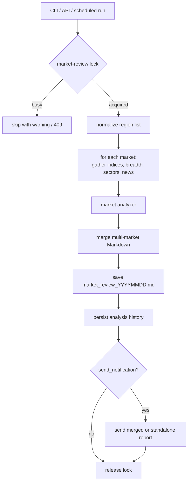

The API endpoint `POST /api/v1/analysis/market-review` submits this flow as a background task
and returns `202` immediately. It also acquires the lock before submitting, so a second request
gets `409`.

---

## 5. Market data acquisition

### 5.1 Provider registry

`data_provider/base.py` defines `BaseFetcher` and `DataFetcherManager`. Fetchers are sorted by
ascending `priority` (lower is tried first). Optional fetchers are only instantiated when their
credentials or endpoint are configured, which avoids unnecessary probes.

| Provider | Typical priority | Daily-bar markets | Notes |
| --- | ---: | --- | --- |
| Efinance | 0 | cn | EastMoney wrapper; high availability, batch behavior |
| AkShare | 1 | cn, hk | Broadest auxiliary capability coverage |
| Tushare | configurable (default 2) | cn, hk | Token-based; priority can be promoted |
| TickFlow | 2 | cn | Optional key; batch daily prefetch, realtime |
| Pytdx | 2 | cn | Tongdaxin protocol; custom servers supported |
| Baostock | 3 | cn | Stable historical fallback |
| Yfinance | 4 | cn, hk, us, jp, kr, tw | Global fallback, especially US/JP/KR/TW |
| Tencent | 5 | cn | Direct daily K-line, final A-share fallback |
| Longbridge | 5 | hk, us | Optional credentials; quote-field supplement |
| Futu | 2 (when configured) | hk | Requires OpenD; also portfolio source |
| Finnhub | 2 | us | Optional key |
| AlphaVantage | 3 | us | Optional key |
| Miaoxiang | configurable (default 6) | none | Vertical supplement: capital flow and chips |

The exact matrix lives in `DataFetcherManager._DAILY_MARKET_FETCHER_SUPPORT`; update it when
adding a provider.

### 5.2 Routing rules

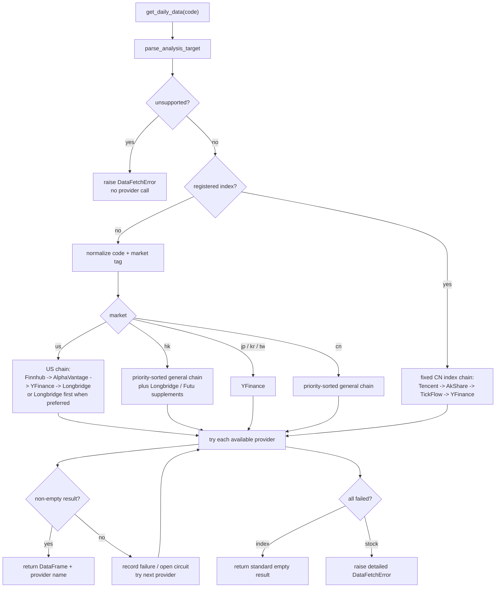

### 5.3 Capability filtering and failover

Before iterating, the manager filters fetchers by:

1. **Market support** (`_filter_daily_fetchers_for_market`).
2. **Capability** (`_filter_fetchers_by_capability`), for example `daily_data`,
   `realtime_quote`, or chip distribution.
3. **Availability probes** (`is_available`, `is_available_for_request`) and circuit-breaker
   health.

Each provider attempt is wrapped in:

- A per-fetcher lock, preventing duplicate concurrent initialization or calls.
- A circuit breaker. The default daily-data breaker opens after three failures for 300 seconds;
  realtime uses 3/300 and chip distribution uses 2/600.
- Provider-run telemetry (`record_provider_run_started`, `record_provider_run`) used by the data
  center diagnostics.
- A timeout budget where the underlying provider supports one.

A single provider failure therefore produces a log entry and a fallback, not a batch failure.

### 5.4 Caches and prefetch

| Cache / prefetch | Scope | Default behavior |
| --- | --- | --- |
| Daily K-line prefetch | Per batch of ≥5 stocks | 30 days through TickFlow when available |
| Realtime quote prefetch | Per batch of ≥5 stocks | Full-market snapshot shared by all stocks |
| Stock-name cache | In-memory | Populated lazily and by bulk prefetch |
| Realtime quote cache | In-memory with TTL | Controlled by `REALTIME_CACHE_TTL` |
| Fundamental context cache | In-memory | TTL 120 s, max 256 entries |
| Concept / sector ranking cache | In-memory | 300 s for non-empty, 30 s for empty |
| Screening snapshot / daily history | On-disk | `data/screening`, configurable TTL |

### 5.5 Fundamentals

`get_fundamental_context()` aggregates multiple capabilities rather than one monolithic call:

- Valuation and market cap.
- Financial growth and profitability.
- Capital flow.
- Industry and board information.
- Market-specific providers (A-share, HK, US).

The aggregation uses a small worker pool and per-capability timeouts (about 8 seconds each) so a
slow provider cannot consume the whole stock-analysis budget. A partial result is valid and is
recorded as such; downstream prompts and reports disclose missing sections.

### 5.6 Search and intelligence

`SearchService` supports seven providers:

| Provider | Config |
| --- | --- |
| Tavily | `TAVILY_API_KEYS` |
| SerpAPI | `SERPAPI_API_KEYS` |
| Bocha | `BOCHA_API_KEYS` |
| Anspire | `ANSPIRE_API_KEYS` |
| MiniMax | `MINIMAX_API_KEYS` |
| Brave | `BRAVE_API_KEYS` |
| SearXNG | `SEARXNG_BASE_URLS`, optional public instances |

`search_comprehensive_intel()` runs up to five dimensions:

1. `latest_news` — recent events with strict freshness.
2. `market_analysis` — analyst ratings, target prices, research.
3. `risk_check` — insider selling, litigation, regulatory risk.
4. `earnings` — revenue/profit expectations, index composition for ETFs/indices.
5. `industry` — competitors, sector allocation, industry outlook.

Queries branch by asset type: foreign tickers use English aliases from the stock mapping, while
domestic tickers use Chinese queries. The pipeline caps this at five searches by default.
Results are formatted into a news context and persisted as `news_intel`.

`IntelligenceService` adds user-configurable sources (RSS, JSON, or HTTP endpoints) and stores
deduplicated items in `intelligence_items`. `SocialSentimentService` adds US-market Reddit/X/
Polymarket context from an external API when `SOCIAL_SENTIMENT_API_KEY` is configured.

---

## 6. Analysis and LLM routing

### 6.1 Config precedence for LLM sources

`src/config.py` resolves three configuration tiers, highest priority first:

1. **`LITELLM_CONFIG`** — a YAML file describing models and router settings.
2. **`LLM_CHANNELS`** — an environment-defined multi-channel configuration.
3. **Legacy provider keys** — `GEMINI_API_KEY`, `ANTHROPIC_API_KEY`, `OPENAI_API_KEY`,
   `DEEPSEEK_API_KEY`, and the Anspire/OpenAI-compatible path.

The resulting `llm_model_list` is used by LiteLLM's `Router`. A legacy single-model setup can
supply `LITELLM_MODEL` and `LITELLM_FALLBACK_MODELS`; otherwise the code derives sensible model
names from the configured provider keys. Channel definitions can be supplied in JSON or a
compact DSL, depending on the variable.

### 6.2 Generation backends

| Backend ID | Used by | Description |
| --- | --- | --- |
| `litellm` | Analysis, agent | Default; routes to any LiteLLM-supported provider |
| `codex_cli` | Analysis, agent UI | Runs a local Codex CLI process |
| `claude_code_cli` | Analysis | Runs a local Claude Code CLI process |
| `opencode_cli` | Analysis | Runs a local OpenCode CLI process |

`GENERATION_BACKEND` selects the analysis backend. `AGENT_GENERATION_BACKEND` selects the agent
backend independently; `auto` resolves to the configured LLM path when possible. Local CLI
backends have concurrency limits, timeouts, and output-size limits because they spawn processes.
They are generation backends, not LiteLLM providers, so they must not be written as
`LITELLM_MODEL=codex_cli/...`.

### 6.3 LLM request flow

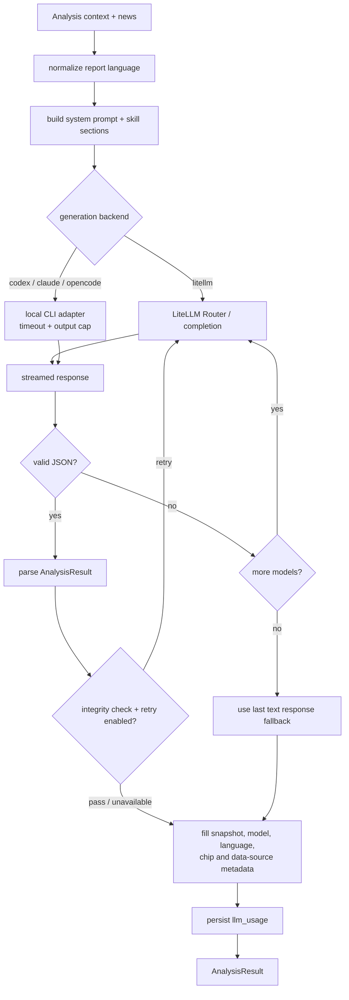

Key analyzer behavior:

- `gemini_request_delay` inserts a pre-request delay to reduce rate-limit pressure.
- The response validator rejects malformed JSON; the analyzer iterates primary and fallback
  models before accepting a text fallback.
- Content integrity checks can trigger one or more retries when mandatory dashboard fields are
  missing.
- A localized failure result is returned when the generation backend cannot start, rather than
  raising into the batch loop.
- LLM usage is persisted with `call_type="analysis"` (agent calls use their own call type),
  including token counts, latency, model, and provider metadata when available.
- Reasoning traces are logged in a redacted/truncated form; secrets and full prompts are not
  written to normal logs.

### 6.4 Report types and decision dashboard

`ReportType` has three values:

| ReportType | Output |
| --- | --- |
| `brief` | 3–5 sentence summary intended for mobile / quick push |
| `simple` | Compact single-stock report |
| `full` | Full decision dashboard report (`detailed` is accepted as an alias) |

The LLM returns JSON with fixed keys. `AnalysisResult` maps that JSON into Python fields,
including:

- Core: code, name, sentiment score (0–100), trend prediction, operation advice, decision type
  (`buy`/`hold`/`sell`), confidence, action taxonomy.
- Dashboard: the full nested decision dashboard.
- Narrative sections: trend, short/medium outlook, technical, MA, volume, pattern, fundamental,
  sector, company highlights, news, sentiment, hot topics, summary, key points, risk warning,
  buy/sell reason.
- Evidence metadata: whether search ran, news result count, whether news evidence was present,
  data sources, model, query ID.
- Snapshot fields: current price and change percent.
- Runtime-only fundamentals and market-structure context, excluded from persisted `to_dict()`.

### 6.5 Market phase and context guardrails

The pipeline builds a market-phase context before analysis. It answers:

- Which session is this (pre-market, intraday, post-market)?
- Is the latest bar partial?
- Which trading date should be treated as the effective daily bar?
- What is the broader market regime?

This context is injected into prompts and also used by guardrails that prevent the model from
making claims that contradict the phase (for example, treating an incomplete intraday bar as a
completed session). Daily market context can be primed once per run and reused across stocks to
avoid repeated market-level analysis.

---

## 7. Agent subsystem

### 7.1 Two execution paths

There are two distinct agent entry points:

| Path | Module | Purpose |
| --- | --- | --- |
| Analysis agent | `src/agent/executor.py` (`AgentExecutor.run`) | Optional replacement for the single LLM analysis call; returns a dashboard |
| Chat agent | `AgentExecutor.chat` + `chat/send` and `chat/stream` APIs | Interactive stock Q&A with tools and session history |

Both use the same tool registry, prompt builder, and `run_agent_loop`. The difference is output
parsing (`parse_dashboard=True` for analysis) and session persistence.

### 7.2 Tool registry

Tools are registered with:

- Name and description.
- OpenAI / Anthropic / MCP-style schema.
- Policy metadata: read-only vs side effects, permissions, stock-scope dimensions.
- Optional per-tool timeout.

Available tools include:

| Category | Tools |
| --- | --- |
| Data | `get_stock_info`, `get_realtime_quote`, `get_daily_history`, `get_chip_distribution`, `get_capital_flow` |
| Analysis | `analyze_trend`, `analyze_pattern`, `calculate_ma`, `get_volume_analysis`, `get_analysis_context` |
| Market | `get_market_indices`, `get_sector_rankings` |
| Search | `search_stock_news`, `search_comprehensive_intel` |
| Backtest / strategy | `get_stock_backtest_summary`, `get_strategy_backtest_summary`, `get_skill_backtest_summary` |
| Portfolio | `get_portfolio_snapshot` |

The registry can be reset at runtime (`reset_tool_registry`) so configuration changes to tool
timeouts and provider settings take effect without restarting the process.

### 7.3 ReAct loop

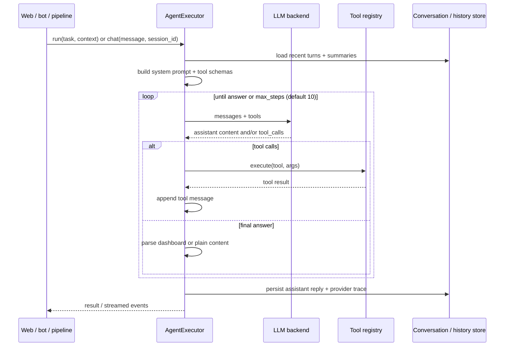

Safety and cost controls:

- `AGENT_MAX_STEPS` (default 10).
- `AGENT_ORCHESTRATOR_TIMEOUT_S` and per-agent timeouts.
- Tool call budgets by category (`AGENT_DATA_TOOL_TIMEOUT_S`,
  `AGENT_SEARCH_TOOL_TIMEOUT_S`, etc.).
- Output-size and context-compression limits.
- Stock scope: tools can be restricted to the current stock.
- Side-effect tools require explicit policy permission.

### 7.4 Single-agent vs multi-agent orchestration

`AGENT_ARCH=single` uses one agent with the full tool set. `AGENT_ARCH=multi` delegates to
specialist agents:

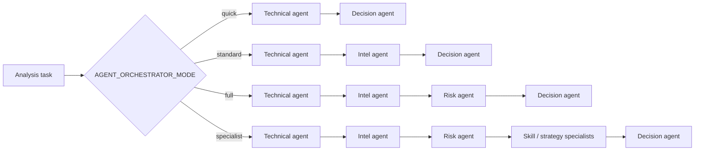

- **quick** is the lowest-latency chain.
- **standard** is the default and adds news/intelligence analysis.
- **full** adds an explicit risk review.
- **specialist** adds skill and strategy evaluation before the final decision.
- The risk agent can veto a buy signal when `AGENT_RISK_OVERRIDE` is enabled.
- Non-critical stage failures (intel, risk, specialist) are recorded as degradations and the
  chain continues.
- The skill engine aggregates opinions, detects consensus/conflicts, and feeds a consolidated
  view into the decision agent.

### 7.5 Skills and strategies

There are two related but distinct concepts:

- **Skills** (`src/agent/skills/`) are executable analysis modules with prompts, tools, and
  aggregation logic. The engine includes an aggregator, deliberation, router, scheduler,
  synthesis, and skill-agent wrapper.
- **Strategies** (`strategies/*.yaml`, loaded by `src/agent/strategies`) are declarative rule
  sets. Each YAML defines name, display name, description, category, core rules, required tools,
  aliases, default behavior, market regimes, and instructions.

Current strategy files:

`bottom_volume`, `box_oscillation`, `bull_trend`, `chan_theory`, `dragon_head`,
`emotion_cycle`, `event_driven`, `expectation_repricing`, `growth_quality`, `hot_theme`,
`ma_golden_cross`, `one_yang_three_yin`, `shrink_pullback`, `volume_breakout`, `wave_theory`.

Skills can be routed automatically (`AGENT_SKILL_ROUTING=auto`) or specified manually
(`AGENT_SKILLS`, `manual`). `AGENT_SKILL_AUTOWEIGHT` enables opinion weighting; skill
performance samples are persisted in `skill_opinion_samples` and evaluated in
`skill_opinion_outcomes`.

### 7.6 Chat sessions and streaming

- Conversation history is stored in `conversation_messages`, with session state and compressed
  summaries in `conversation_session_states` and `conversation_summaries`.
- `agent_provider_turns` records provider-level turns for debugging and trajectory evaluation.
- `POST /api/v1/agent/chat/stream` exposes SSE progress, including tool-call events and final
  content; `.../cancel` cancels an in-flight request.
- `POST /api/v1/agent/research` runs a deeper research workflow with token/time budgets
  (`AGENT_DEEP_RESEARCH_BUDGET`, `AGENT_DEEP_RESEARCH_TIMEOUT`).

The event contract is documented in
[`docs/agent-stream-events.md`](./docs/agent-stream-events.md).

---

## 8. Reports and notifications

### 8.1 Report generation

Per-stock results are rendered into Markdown by the notification/report layer:

1. `AnalysisResult` -> report data.
2. Optional Jinja2 template rendering (`report_renderer`, default disabled).
3. Format-specific transformations:
   - Markdown to HTML.
   - Markdown to plain text.
   - Feishu/Slack/Telegram-specific formatting.
   - Message chunking for channel limits.
4. Optional Markdown-to-image conversion for channels that render images better than long text.
5. Save to `reports/report_YYYYMMDD.md`.
6. Persist analysis history and optional context snapshot.

Templates live in `templates/`:

- `report_brief.j2`
- `report_markdown.j2`
- `report_wechat.j2`
- `_macros.j2`

The aggregate report uses either `generate_brief_report` or `generate_dashboard_report`,
depending on report type. It reuses per-stock results and does not make another LLM call.

### 8.2 Notification channels

| Channel | Module | Notes |
| --- | --- | --- |
| WeChat Work | `wechat_sender.py` | Markdown, chunking, optional image conversion |
| DingTalk | `dingtalk_sender.py` | Webhook delivery; bot Stream mode lives in `bot/platforms/` |
| Feishu | `feishu_sender.py` | Text, cards, file upload, cloud docs |
| Telegram | `telegram_sender.py` | HTML formatting and chunking |
| Email | `email_sender.py` | SMTP, HTML/plain alternatives, stock groups |
| Pushover | `pushover_sender.py` | Mobile/desktop push |
| ntfy | `ntfy_sender.py` | Topic-based push |
| Gotify | `gotify_sender.py` | Self-hosted push |
| PushPlus | `pushplus_sender.py` | Domestic push service |
| ServerChan3 | `serverchan3_sender.py` | Domestic push service |
| Custom webhook | `custom_webhook_sender.py` | Configurable JSON payload |
| Discord | `discord_sender.py` | Webhook or bot |
| Slack | `slack_sender.py` | Webhook |
| AstrBot | `astrbot_sender.py` | AstrBot integration |

### 8.3 Delivery pipeline

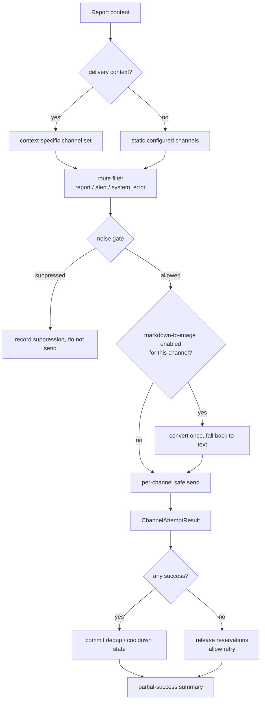

### 8.4 Routing and noise control

- Route types: `report`, `alert`, `system_error`.
- `NOTIFICATION_REPORT_CHANNELS`, `NOTIFICATION_ALERT_CHANNELS`, and
  `NOTIFICATION_SYSTEM_ERROR_CHANNELS` restrict which channels receive each route.
- Dedup: `NOTIFICATION_DEDUP_TTL_SECONDS` suppresses identical content within a window.
- Cooldown: `NOTIFICATION_COOLDOWN_SECONDS` limits repeated sends of the same class.
- Quiet hours: `NOTIFICATION_QUIET_HOURS` with `NOTIFICATION_TIMEZONE`.
- Minimum severity: `NOTIFICATION_MIN_SEVERITY` for alert/system routes.
- Daily digest is a reserved config and is not currently sent.
- In-flight reservations prevent two concurrent workers from sending the same notification.
- Noise state is process-local. Multiple workers/containers do not share it.

### 8.5 Merged stock + market review delivery

When `merge_email_notification` (or the CLI merge path) is enabled and both stock analysis and
market review run, the individual components can suppress their own sends. `main.py` merges the
rendered sections and sends once. This avoids duplicate emails in a scheduled daily run.

### 8.6 Feishu cloud documents

`src/feishu_doc.py` can create a Feishu cloud document from a report when `FEISHU_APP_ID`,
`FEISHU_APP_SECRET`, and the target folder token are configured. Failures are logged and do not
block the analysis.

---

## 9. Persistence layer

### 9.1 Database technology

`src/storage.py` uses SQLAlchemy over SQLite by default (`DATABASE_PATH`, typically
`data/stock_analysis.db`). Key behaviors:

- WAL mode is enabled for file-backed SQLite (`SQLITE_WAL_ENABLED`).
- Busy timeout and write retries are configurable.
- `Base.metadata.create_all()` creates missing tables.
- Lightweight schema migrations add columns/indexes and record a baseline in `schema_migrations`.
- The current baseline version is `2026-06-05-create-all-baseline`.

The manager is a singleton (`DatabaseManager`), and repositories in `src/repositories/` provide
focused query helpers for API services.

### 9.2 Table groups

| Group | Tables |
| --- | --- |
| Schema | `schema_migrations` |
| Market data | `stock_daily` |
| News / intelligence | `news_intel`, `intelligence_sources`, `intelligence_items` |
| Fundamentals | `fundamental_snapshot` |
| Analysis | `analysis_history` |
| Screening | `screening_runs` |
| Backtest | `backtest_results`, `backtest_summaries` |
| Portfolio | `portfolio_accounts`, `portfolio_trades`, `portfolio_cash_ledger`, `portfolio_corporate_actions`, `portfolio_positions`, `portfolio_position_lots`, `portfolio_daily_snapshots`, `portfolio_fx_rates` |
| Agent conversation | `conversation_messages`, `conversation_session_states`, `conversation_summaries`, `agent_provider_turns` |
| Telemetry | `llm_usage` |
| Alerts | `alert_rules`, `alert_triggers`, `alert_notifications`, `alert_cooldowns` |
| Decision signals | `decision_signals`, `decision_signal_outcomes`, `decision_signal_feedback` |
| Skill learning | `skill_opinion_samples`, `skill_opinion_outcomes` |

### 9.3 Conceptual relationships

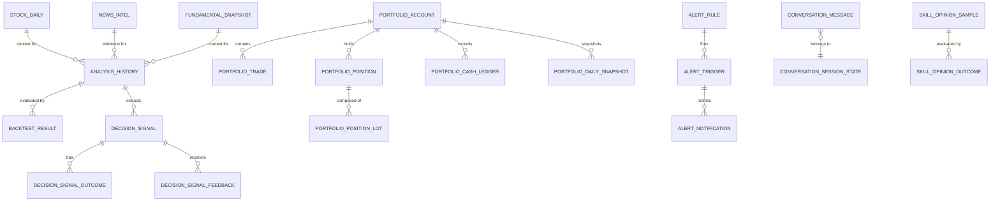

### 9.4 Important record shapes

**`analysis_history`** stores the durable output of every analysis:

- `query_id`, `code`, `name`, `report_type`
- `sentiment_score`, `operation_advice`, `trend_prediction`, `analysis_summary`
- `raw_result` (full JSON), `news_content`, `context_snapshot`
- `ideal_buy`, `secondary_buy`, `stop_loss`, `take_profit`
- `created_at`

**`decision_signals`** turns an analysis into an actionable plan:

- Stock identity and market.
- Source type/agent/report/trace IDs and decision profile.
- Market phase and trigger source.
- Action, label, confidence, score, horizon.
- Entry range, stop loss, target, invalidation, watch conditions.
- Reason, risk summary, catalyst summary, evidence JSON, data-quality JSON.
- Plan quality, status, expiry, timestamps, metadata.

Decision outcomes and feedback are stored separately, which allows retrospective evaluation
without mutating the original signal.

**`llm_usage`** records model telemetry: provider/model, call type, prompt/completion tokens,
latency, success/error, and request metadata. It powers the usage dashboard.

### 9.5 Retention and cleanup

- Task history is capped in memory (100 tasks by default) and is not persisted.
- Flow events are capped per task (200 events).
- `news_intel` retention is configurable.
- Scheduled-analysis occurrence claims are cleaned after seven days.
- Alert cooldowns and notification attempts are retained for audit and diagnostics.

---

## 10. HTTP API, task queue, and authentication

### 10.1 FastAPI application

`api/app.py` builds the app with:

- A lifespan handler that creates the runtime scheduler, system config service, stock-index
  refresh task, and warms the AkShare name resolver.
- CORS for local Vite ports plus `CORS_ORIGINS`; `CORS_ALLOW_ALL` is a development escape hatch
  and logs a warning when auth is disabled.
- Optional authentication middleware for `/api/v1/*`.
- `/api/v1` router aggregation.
- Error handlers.
- SPA static serving with path containment for `/assets/*`, MIME registration, and a
  “frontend not built” page when `static/index.html` is missing.
- `/health` and `/api/health`.
- `/stocks.index.json` served from the stock-index asset.

### 10.2 Endpoint groups

All paths below are relative to `/api/v1` unless noted.

| Prefix | Main endpoints | Purpose |
| --- | --- | --- |
| `/auth` | `status`, `settings`, `login`, `logout`, `change-password` | Optional admin authentication |
| `/agent` | `models`, `status`, `skills`, `strategies`, `chat`, `chat/send`, `chat/stream`, session CRUD, `research` | Agent chat and research |
| `/analysis` | `analyze`, `market-review`, `status/{task_id}`, `tasks`, `tasks/stream`, `tasks/{task_id}/flow` | Analysis and background task control |
| `/history` | `stocks`, `by-code/{code}`, `{id}`, `{id}/diagnostics`, `{id}/flow`, `{id}/markdown`, `{id}/news`, `{id}/share-image`, `{id}/share-image-html` | Analysis history and exports |
| `/stocks` | `watchlist`, `watchlist/add`, `watchlist/remove`, `extract-from-image`, `parse-import`, `{code}/history`, `{code}/profile`, `{code}/quote` | Watchlist and stock data |
| `/backtest` | `run`, `results`, `performance`, `performance/{code}` | Historical evaluation |
| `/system` | `config`, `config/schema`, `config/export`, `config/import`, `config/validate`, `config/setup/status`, LLM/notification/backend diagnostics, `scheduler/status`, `scheduler/run-now` | Settings and operations |
| `/usage` | `summary`, `dashboard` | LLM token/cost telemetry |
| `/portfolio` | Accounts, trades, cash ledger, corporate actions, positions, snapshot, risk, FX refresh, CSV import | Portfolio management |
| `/alerts` | Rule CRUD, enable/disable, test, triggers, notifications | Event-driven alerts |
| `/decision-signals` | Latest/list, outcomes, outcome run/stats, reassess, stock review, feedback, status | Decision signal lifecycle |
| `/screening` | status, strategies, hotspots, screen, screen/check, async tasks, history, source-history | Multi-strategy stock screening |
| `/data` | `capabilities`, `overview` | Data-source diagnostics |
| `/intelligence` | Source CRUD, templates, defaults, test, fetch, items | Intelligence source management |
| `/health` | `GET /api/v1/health` | Health probe |

### 10.3 Analysis request contract

`AnalyzeRequest` supports:

- `stock_code` or `stock_codes` (maximum 50 non-empty tokens).
- `report_type`: `simple`, `detailed`, `full`, or `brief`.
- `force_refresh`.
- `async_mode`.
- `analysis_phase`: `auto`, `premarket`, `intraday`, `postmarket`.
- `stock_name`, `original_query`, `selection_source`.
- `notify`.
- `report_language`: `zh`, `en`, `ko`.
- `skills` (aliases: `strategies`).

Input handling:

1. Code-like tokens go through `parse_analysis_target`; names use the legacy resolver.
2. Unsupported targets are rejected before any provider call.
3. Index targets dedupe by canonical ID, so `sh000016` and a stock `000016` are distinct.
4. Stock codes dedupe by normalized code, so `600519` and `600519.SH` merge.
5. Synchronous mode accepts one stock; asynchronous mode accepts a batch.

### 10.4 Task queue lifecycle

`src/services/task_queue.py` implements an in-process queue:

- Singleton `AnalysisTaskQueue`.
- `ThreadPoolExecutor` with `MAX_WORKERS` workers (default 3).
- Deduplication by stock + canonical target while a task is active.
- 100-task history.
- 200 flow events per task.
- Batch submission rolls back accepted tasks if executor submission fails.
- Runtime concurrency changes are deferred while the queue is busy.

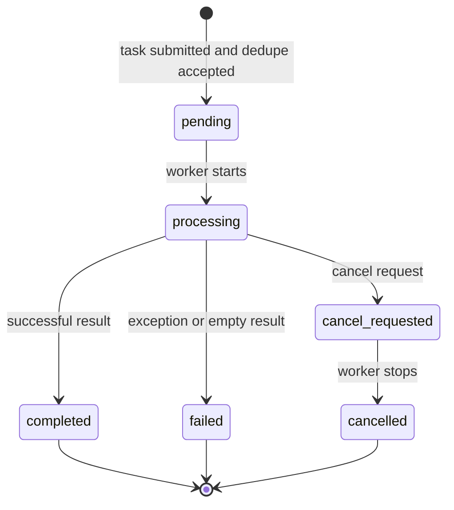

SSE events:

- `connected`
- `task_created`
- `task_started`
- `task_progress`
- `task_completed`
- `task_failed`
- `heartbeat` (every 30 seconds)

The stream endpoint is `GET /api/v1/analysis/tasks/stream`; task snapshots are also available
from `GET /api/v1/analysis/tasks`.

### 10.5 Run-flow diagnostics

`src/services/run_diagnostics` (and the API endpoints `/{id}/flow` and
`/tasks/{task_id}/flow`) records a structured sequence of pipeline events:

- Phase transitions.
- Provider attempts and fallbacks.
- Search calls and result counts.
- Agent steps and tool calls.
- LLM calls and model selection.
- Persistence and notification outcomes.

The context is activated at task entry and propagated through thread-local state. This is the
primary tool for answering “why did this run take so long or skip a stage?”

### 10.6 Authentication

Authentication is optional and controlled by `ADMIN_AUTH_ENABLED`.

- Credentials are stored in a local file under the data directory, not in `.env`.
- Passwords use PBKDF2-HMAC-SHA256 with 100,000 iterations and a random salt.
- Sessions are HMAC-signed cookies named `dsa_session`.
- `ADMIN_SESSION_MAX_AGE_HOURS` defaults to 24 hours.
- Login attempts are rate-limited per client IP.
- `TRUST_X_FORWARDED_FOR` controls whether a single trusted reverse proxy may supply the real
  IP; leave it off for direct public exposure.
- Exempt paths: login, auth status, health checks, OpenAPI docs, `/docs`, `/redoc`.
- Password reset CLI: `python -m src.auth reset_password`.

If auth is disabled and CORS is fully open, the app logs a prominent warning because the API is
effectively public.

---

## 11. Web UI, desktop app, and bots

### 11.1 Web stack

| Layer | Choice |
| --- | --- |
| Framework | React 19 |
| Routing | `react-router-dom` 7 |
| State | Zustand 5 |
| Styling | Tailwind CSS 4 |
| Build | Vite 7 + TypeScript 5.9 |
| Charts | Recharts 3 |
| Markdown | `react-markdown` + `remark-gfm` |
| Tests | Vitest 4 + Playwright |

Main routes:

| Route | Page | Purpose |
| --- | --- | --- |
| `/` | `HomePage` | Watchlist, analysis launcher, dashboard |
| `/chat` | `ChatPage` | Agent chat with tool progress |
| `/portfolio` | `PortfolioPage` | Positions, trades, cash, risk |
| `/decision-signals` | `DecisionSignalsPage` | Signal list, outcomes, review |
| `/screening` | `StockScreeningPage` | Strategy screening and results |
| `/data` | `DataCenterPage` | Provider capabilities and diagnostics |
| `/backtest` | `BacktestPage` | Historical performance |
| `/alerts` | `AlertsPage` | Alert rules and triggers |
| `/usage` | `TokenUsagePage` | LLM usage telemetry |
| `/settings` | `SettingsPage` | Schema-driven configuration |
| `/login` | `LoginPage` | Optional admin login |

State stores: `analysisStore`, `agentChatStore`, `stockPoolStore`.

API clients mirror the backend groups: `analysis`, `agent`, `history`, `stocks`, `systemConfig`,
`backtest`, `screening`, `portfolio`, `alerts`, `decisionSignals`, `usage`, `dataCapability`,
`auth`.

### 11.2 Settings page contract

The settings page is generated from `GET /api/v1/system/config/schema`. Each field carries:

- Key, title, description, category, data type.
- UI control, sensitive flag, required/editable flags.
- Default, options, validation, display order.
- Help key, examples, documentation link.

Saving uses optimistic concurrency:

1. The client sends the `config_version` it read.
2. The server compares it with `mtime_ns:sha256` of `.env`.
3. A mismatch returns `409` instead of overwriting concurrent edits.
4. Sensitive values sent back as `******` are skipped, preserving the stored secret.
5. The file is written atomically through a temporary file and `os.replace`, with an in-place
   fallback for bind mounts that do not support rename.
6. Runtime singletons are reset, `.env` is reloaded, and validation warnings are returned.
7. Scheduler settings trigger reconciliation when changed.

### 11.3 Desktop application

`apps/dsa-desktop/main.js`:

- Spawns the packaged Python backend (`dist/backend/stock_analysis`).
- Finds a free port in 8000–8100.
- Waits for `/api/health` before loading the SPA.
- Injects database, log, and env paths.
- Backs up and restores user data during updates.
- Uses `electron-updater` against GitHub releases.
- Builds NSIS installers on Windows and DMG packages on macOS.

The desktop app is a shell, not a separate backend implementation. Fixes to API or analysis
behavior automatically apply once the packaged backend is rebuilt.

### 11.4 Bots

`bot/` contains platform adapters and a shared dispatcher. Commands:

| Command | Purpose |
| --- | --- |
| `help` | Command list |
| `status` | Runtime/config status |
| `analyze` | Analyze one stock |
| `market` | Market review |
| `batch` | Analyze multiple stocks |
| `ask` | Ask a question with the agent |
| `chat` | Continue a conversation |
| `research` | Deeper research |
| `strategies` | List skills/strategies |
| `history` | Recent analysis history |

Supported platforms:

- Feishu Stream client (text, replies, interactive cards, chunking).
- DingTalk webhook and Stream modes.
- Discord webhook and interactions.

The dispatcher applies rate limits, admin-user checks, and command parsing. Bot analysis uses
the same pipeline and can trigger notifications according to route settings.

---

## 12. Scheduling

### 12.1 Schedule configuration

| Variable | Default | Meaning |
| --- | --- | --- |
| `SCHEDULE_ENABLED` | `false` | Enable schedule mode |
| `SCHEDULE_TIME` | `18:00` | Single daily time, `HH:MM` |
| `SCHEDULE_TIMES` | empty | Comma-separated multiple times; overrides `SCHEDULE_TIME` |
| `SCHEDULE_RUN_IMMEDIATELY` | `true` | Run once at startup |
| `DSA_RUNTIME_SCHEDULER_TIMEOUT_SECONDS` | `2700` (45 min) | Hard timeout for one scheduled analysis |
| `DSA_TIMEOUT_PARTIAL_NOTIFY` | `true` | Notify partial results after timeout |
| `MARKET_REVIEW_ENABLED` | `true` | Include market review |
| `MARKET_REVIEW_REGION` | `cn` | `cn`, `hk`, `us`, `jp`, `kr`, `both`, or a subset |
| `TRADING_DAY_CHECK_ENABLED` | `true` | Skip when no configured market is open |

`normalize_schedule_times()` validates each entry, removes duplicates, sorts them, and falls
back to `18:00` when no valid time is supplied.

### 12.2 Runtime scheduler

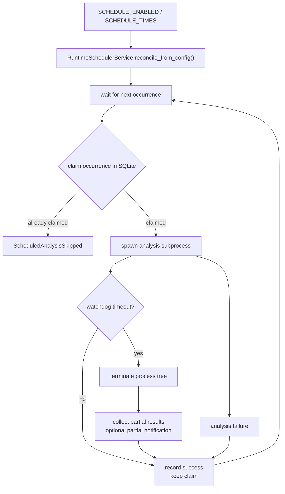

Properties:

- `_RUNTIME_ANALYSIS_LOCK` prevents concurrent scheduled runs in one process.
- A busy scheduler skips the new occurrence with reason `analysis_already_running`.
- Occurrence claims use the `scheduled_analysis_claims` table with a composite key of
  occurrence and workload hash, an `INSERT OR IGNORE`, and seven-day cleanup.
- The claim is intentionally **kept after failure** because notifications may already have been
  sent. A manual re-run is required rather than silent duplicate delivery.
- Startup immediate runs and manual run-now are not deduplicated.
- `status` returns enabled/running state, schedule times, next/last run, last success, last
  error, and last skip reason.

### 12.3 Trading-day gate

The CLI computes a per-market trading-day filter before running:

- Uses exchange calendars where available (`exchange-calendars`).
- Honors market-specific holidays.
- Allows `--force-run` to bypass the gate.
- Scheduled runs pass their own occurrence context so the gate matches the intended session.

The Web-triggered manual market review endpoint explicitly does **not** apply the trading-day
gate; it is treated as an operator override.

---

## 13. Configuration and settings

### 13.1 Precedence

`Config` is a dataclass singleton loaded from environment variables after `setup_env()` reads
`.env`.

General precedence:

```text
process environment > .env file > code defaults
```

Exception: a small set of WebUI-managed runtime keys prefer the persisted `.env` copy, while
still honoring an explicit process environment override captured at bootstrap:

- `STOCK_LIST`
- `RUN_IMMEDIATELY`
- `SCHEDULE_ENABLED`
- `SCHEDULE_TIME`
- `SCHEDULE_TIMES`
- `SCHEDULE_RUN_IMMEDIATELY`

This lets the settings page change the watchlist and schedule for the running service without
requiring a restart, while Docker/GitHub Actions environment overrides still win.

### 13.2 LLM source precedence

```text
LITELLM_CONFIG (YAML) > LLM_CHANNELS (env) > legacy provider keys
```

The resolved source is exposed as `llm_models_source` for diagnostics.

### 13.3 Settings registry

`src/core/config_registry.py` defines the settings schema used by the API and Web page. It
explicitly registers 189 keys across:

| Category | Keys |
| --- | ---: |
| `agent` | 24 |
| `ai_model` | 40 |
| `backtest` | 5 |
| `base` | 2 |
| `data_source` | 30 |
| `notification` | 63 |
| `system` | 25 |

Keys that are not registered still receive inferred metadata (title, type, control, and
sensitivity), so the schema can expose newly added environment variables without a registry
change. Per-field long-form help text lives in
[`apps/dsa-web/src/locales/settingsHelp.ts`](./apps/dsa-web/src/locales/settingsHelp.ts); its
maintenance rules are documented in [`docs/settings-help.md`](./docs/settings-help.md).
[`.env.example`](./.env.example) documents the main runtime variables with inline comments.

### 13.4 Major configuration groups

| Group | Representative variables |
| --- | --- |
| Watchlist / targets | `STOCK_LIST`, `STOCK_GROUP_N`, `--portfolio futu` (CLI) |
| LLM | `LITELLM_CONFIG`, `LLM_CHANNELS`, provider keys, `LITELLM_MODEL`, `LITELLM_FALLBACK_MODELS`, `LLM_TEMPERATURE`, `ANTHROPIC_MAX_TOKENS` |
| Generation backends | `GENERATION_BACKEND`, `GENERATION_FALLBACK_BACKEND`, `GENERATION_BACKEND_TIMEOUT_SECONDS`, `OPENCODE_CLI_MODEL` |
| Agent | `AGENT_BACKEND`, `AGENT_MODE`, `AGENT_ARCH`, `AGENT_ORCHESTRATOR_MODE`, `AGENT_MAX_STEPS`, `AGENT_SKILLS`, `AGENT_SKILL_ROUTING`, `AGENT_RISK_OVERRIDE`, timeouts |
| Market data | `TUSHARE_TOKEN`, `TICKFLOW_API_KEY`, `MX_APIKEY`, `LONGBRIDGE_*`, `FINNHUB_API_KEY`, `ALPHAVANTAGE_API_KEY`, `*_PRIORITY` |
| Realtime | `ENABLE_REALTIME_QUOTE`, `REALTIME_SOURCE_PRIORITY`, `FUTU_HK_REALTIME_SOURCE_PRIORITY`, `REALTIME_CACHE_TTL` |
| Fundamentals | `ENABLE_FUNDAMENTAL_PIPELINE`, `FUNDAMENTAL_STAGE_TIMEOUT_SECONDS`, `FUNDAMENTAL_CACHE_TTL_SECONDS` |
| Search | `TAVILY_API_KEYS`, `SERPAPI_API_KEYS`, `BOCHA_API_KEYS`, `ANSPIRE_API_KEYS`, `MINIMAX_API_KEYS`, `BRAVE_API_KEYS`, `SEARXNG_*` |
| News / intelligence | news window and retention, `NEWSNOW_BASE_URL`, intelligence source settings |
| Reports | `REPORT_TYPE`, `REPORT_LANGUAGE`, `REPORT_SUMMARY_ONLY`, `REPORT_SHOW_LLM_MODEL`, `REPORT_RENDERER_ENABLED`, `REPORT_INTEGRITY_ENABLED`, `REPORT_INTEGRITY_RETRY` |
| Notifications | channel credentials, route lists, `NOTIFICATION_*` noise controls, `WEBHOOK_VERIFY_SSL`, image conversion |
| Scheduler | `SCHEDULE_*`, `MARKET_REVIEW_*`, `RUN_IMMEDIATELY`, runtime timeout |
| System | `MAX_WORKERS`, `LOG_DIR`, `LOG_LEVEL`, `DATABASE_PATH`, `WEBUI_*`, `ADMIN_AUTH_ENABLED` |
| Screening | `SCREENING_ENABLED`, `SNAPSHOT_SOURCE_PRIORITY`, `LLM_TIMEOUT_SEC`, `LLM_MAX_TOKENS`, timeout overrides, cache paths, `INDUSTRY_PROVIDER` |
| Portfolio | Futu OpenD, FX, risk, CSV import settings |
| Backtest | evaluation window, minimum age, auto-backtest behavior |
| ETF rotation | pool, safe asset, lookback, top N, rebalance, cost |

### 13.5 Validation

`Config.validate_structured()` returns issues with severity `error`, `warning`, or `info` and a
field name. Examples:

- `STOCK_LIST` must not be empty.
- Email sender and password must be configured together.
- `GENERATION_BACKEND` must be supported.
- Local CLI backends cannot be used as LiteLLM providers.
- `AGENT_BACKEND=codex_app_server` requires `AGENT_ARCH=single`.
- Tushare, search providers, and notification channels produce informational or warning issues
  when partially configured.

Errors block saving through the settings API; warnings are returned to the client.

### 13.6 Hot reload

`Config.reset_instance()` clears the singleton. Reloading also resets:

- The agent tool registry.
- The shared data-fetcher manager.
- The search service.
- The runtime scheduler reconciliation state.

This is why changing a provider key or tool timeout in the settings page can take effect without
restarting the process. Long-running requests keep their existing config object.

---

## 14. Adjacent features

### 14.1 Portfolio

The portfolio subsystem stores accounts, trades, cash movements, corporate actions, positions,
position lots, daily snapshots, and FX rates. It supports:

- Manual account/trade management.
- CSV import with broker detection and a preview/commit flow.
- Futu OpenD portfolio import for analysis targets.
- Position-level analysis.
- Snapshot and risk endpoints.
- FX refresh with fallback behavior.

Portfolio context can be injected into analysis so the LLM knows about concentration and holding
risk.

### 14.2 Screening

The screening pipeline runs in layers:

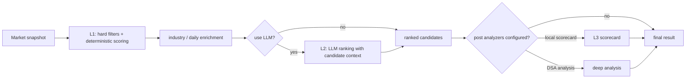

Strategies in `src/services/screening/strategies/`:

`balanced_alpha`, `blue_chip_income`, `capital_heat`, `dual_low`, `low_volatility_quality`,
`momentum_quality`, `oversold_reversal`, `quality_value`, `shrink_pullback`, `volume_breakout`.

The engine supports cached snapshots, last-good fallback, per-source timeouts, hotspot browsing,
synchronous and asynchronous screening, and history retrieval. It is disabled unless
`SCREENING_ENABLED=true`.

### 14.3 Decision signals

`DecisionSignalService` extracts a structured, actionable plan from an analysis result:

- Entry range, stop loss, target, horizon, invalidation.
- Watch conditions.
- Risk and catalyst summaries.
- Evidence and data-quality metadata.
- Plan quality and status.

The outcome service later evaluates signals against subsequent price action; the reassess
service updates stale signals. Feedback is user-provided and stored separately. The Web page
`/decision-signals` exposes the lifecycle.

### 14.4 Alerts

`AlertWorker` evaluates runtime and legacy alert rules:

- Indicators such as price, volume, MA crosses, portfolio exposure, and market light state.
- Deduplication and cooldowns.
- Trigger and notification-attempt records.
- Decision-signal summaries attached to alerts.
- Notification route `alert`.

Legacy JSON rules support only three basic single-symbol rule types; richer technical, watchlist,
portfolio, and market-light rules are configured through the Web/API alert center.

### 14.5 Backtest

`BacktestService` selects analysis records that have not yet been evaluated (or all records when
forced), resolves the analysis date, fetches forward daily bars, and writes:

- `backtest_results` — per-record direction correctness, return, stop/target hits, first hit,
  trading days.
- `backtest_summaries` — aggregated metrics.

`BacktestEngine` is database-agnostic and long-only. It infers expected direction from Chinese
or English operation advice, handles negation, and applies a neutral band (default 2%) before
scoring direction. Engine version is recorded for reproducibility.

### 14.6 ETF rotation

`--etf-rotation` runs a deterministic dual-momentum strategy with no LLM:

1. Load forward-adjusted closes for the risk pool and a safe asset.
2. Use the latest completed A-share session as `as_of`.
3. Rank risk assets by lookback return (default 60 days).
4. Keep only positive-momentum assets (absolute momentum).
5. Pick the top N (default 2).
6. Apply a switch buffer (default 2%) to reduce churn.
7. Allocate empty slots to the safe asset (default `511880`) or cash.
8. Rebalance weekly (default) or monthly, with a one-day execution lag and 10 bps one-way cost.
9. Produce a Markdown report with signal, backtest metrics, annual returns, parameter sweep, and
   trade history; save and optionally notify.

The default pool is `510300`, `510500`, `159915`, `512890`, `513100`, `518880`. If the available
history is shorter than the minimum backtest period, the report is reduced to the latest signal
with an explicit warning.

### 14.7 LLM usage telemetry

Each LLM call can persist a row in `llm_usage` with:

- Provider and model.
- Call type (analysis, agent, research, etc.).
- Prompt/completion/total tokens.
- Latency and success/error.
- Request identifiers and optional HMAC-protected message metadata.

`/api/v1/usage/summary` and `/dashboard` aggregate this data for the usage page.

---

## 15. Deployment and CI/CD

### 15.1 Local development

```bash
# Backend
python -m venv .venv
source .venv/bin/activate        # Windows: .venv\Scripts\activate
pip install -r requirements.txt
cp .env.example .env
python main.py --serve-only

# Web
cd apps/dsa-web
npm ci
npm run dev

# Desktop
cd apps/dsa-desktop
npm install
npm run dev
```

The Vite dev server proxies API calls to the FastAPI backend. For production, build the Web app
and let FastAPI serve `static/`.

### 15.2 Docker

`docker/Dockerfile` is a multi-stage build:

1. `node:20-slim` builds the Web app.
2. `python:3.11-slim-bookworm` installs runtime dependencies, `wkhtmltopdf`, and CJK fonts.
3. A non-root `dsa` user (UID 1000) runs the application.
4. Volumes: `/app/data`, `/app/logs`, `/app/reports`.
5. Health check probes `/api/health` then `/health`.
6. Default command: `python main.py --schedule`.

`docker/docker-compose.yml` defines two services sharing the same image and `.env`:

- `analyzer` — schedule mode.
- `server` — `main.py --serve-only --host 0.0.0.0 --port ${API_PORT:-8000}`.

Do **not** bind-mount `.env` as a single file into `/app/.env`; the mount point prevents the
atomic rename used by settings saves. Use `env_file` as the compose file does.

### 15.3 GitHub Actions

| Workflow | Trigger | Purpose |
| --- | --- | --- |
| `00-daily-analysis.yml` | Weekdays 10:00 UTC (18:00 CST), manual | Daily analysis run |
| `auto-tag.yml` | Push to `main` | Opt-in version bump via `#patch` / `#minor` / `#major` in commit title |
| `ci.yml` | PR to `main` | Change detection, AI governance, 3 backend shards, backend gate, Docker build, desktop packaging, Web gate |
| `create-release.yml` | Tag push | GitHub release creation |
| `desktop-release.yml` | Tags / manual | Desktop installers |
| `docker-publish.yml` | Tags / manual | Container image publication |
| `ghcr-dockerhub.yml` | Manual | GHCR/Docker Hub multi-registry publish |
| `network-smoke.yml` | Weekdays 02:00 UTC | Network-dependent smoke tests |
| `pr-review.yml` | PR events | Static security checks, AI review, labeling, comment |
| `stale.yml` | Daily | Stale issue/PR management |

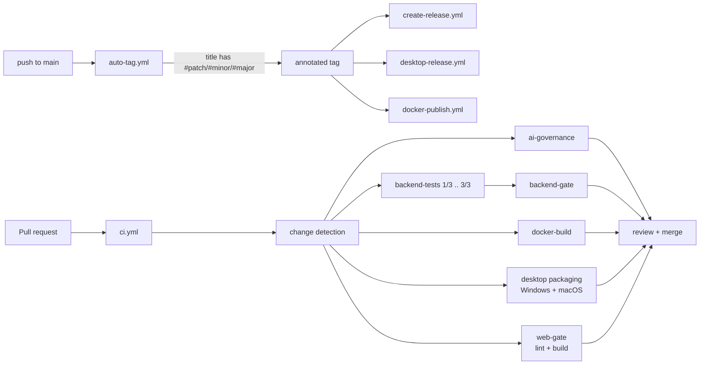

### 15.4 Desktop packaging

Desktop release builds:

1. Build the Web SPA.
2. Freeze the Python backend with PyInstaller into `dist/backend/stock_analysis`.
3. Package Electron with `electron-builder`.
4. Produce NSIS (Windows) and DMG (macOS) artifacts.
5. Upload to the GitHub release.

The desktop updater checks GitHub releases and restores user data after an update.

---

## 16. Extension recipes

### 16.1 Add a market data provider

1. Implement a subclass of `BaseFetcher` in `data_provider/`.
2. Declare `name`, `priority`, capability methods (`get_daily_data`, `get_realtime_quote`, etc.),
   and availability probes.
3. Register it in `DataFetcherManager._init_default_fetchers()` behind a credential check.
4. Add it to `_DAILY_MARKET_FETCHER_SUPPORT` if it provides daily bars.
5. Add capability-specific routing if it should be preferred for a market.
6. Add tests for normalization, empty results, and failure fallback.
7. Update `.env.example`, `docs/market-support.md`, and `docs/data-source-stability.md`.

### 16.2 Add an LLM channel

1. Add the channel to `LLM_CHANNELS` or `LITELLM_CONFIG`.
2. Use a provider prefix supported by LiteLLM.
3. Include it in `LITELLM_FALLBACK_MODELS` if it should be a fallback.
4. Add a smoke test through the settings page’s LLM capability checks.
5. Update `docs/LLM_CONFIG_GUIDE.md` if the variable shape is new.

### 16.3 Add an agent skill or strategy

For a declarative strategy:

1. Add `strategies/<name>.yaml` with the required schema.
2. Add tests that load and validate it.
3. Verify it appears in `/api/v1/agent/strategies`.
4. Document market regimes and required tools.

For an executable skill:

1. Add a module under `src/agent/skills/`.
2. Implement the required prompt/tool/evaluation interface.
3. Register it in the skill registry/router.
4. Add an evaluation sample and backtest coverage.

### 16.4 Add a notification channel

1. Add a sender module in `src/notification_sender/`.
2. Add the channel to `NotificationChannel`.
3. Wire configuration loading and masking.
4. Implement `send()` with structured `ChannelAttemptResult`.
5. Add it to `ROUTABLE_NOTIFICATION_CHANNELS` in `src/notification_routing.py`.
6. Add it to the config registry, `.env.example`, and `docs/notifications.md`.
7. Add tests for success, failure, and partial failure.

### 16.5 Add an API endpoint

1. Create or extend a router in `api/v1/endpoints/`.
2. Define request/response schemas in `api/v1/schemas/`.
3. Register the router in `api/v1/router.py`.
4. Use `get_config_dep` and `get_database_manager` dependencies.
5. Follow the existing error shape (`ErrorResponse`).
6. Add an API client in `apps/dsa-web/src/api/` and a page/component if user-visible.
7. Add tests under `tests/`.

### 16.6 Add a configuration key

1. Add the field to `Config` with a sensible default.
2. Parse it in `_load_from_env()`.
3. Add metadata to `src/core/config_registry.py`.
4. Add it to `.env.example` with a comment.
5. Add validation if it has constraints.
6. Update `apps/dsa-web/src/locales/settingsHelp.ts` and any relevant subsystem guide.
7. Add a test that the default and override both load.

---

## 17. Troubleshooting and glossary

### 17.1 Common symptoms

| Symptom | Likely cause | Where to look |
| --- | --- | --- |
| `STOCK_LIST` validation error | Empty watchlist | `.env` / settings page |
| All providers fail for a stock | Unsupported market, network, or every circuit open | `data_provider/` logs, `/api/v1/data/capabilities` |
| Analysis returns empty news | Search providers unconfigured or quota exhausted | `NEWS_*` / search keys, `news_result_count` |
| LLM returns invalid JSON | Model or prompt incompatibility | `GENERATION_BACKEND`, `LITELLM_MODEL`, analyzer logs |
| Notifications partially fail | One channel misconfigured or rate-limited | `ChannelAttemptResult`, notification diagnostics |
| Scheduled run skipped | No market open or occurrence already claimed | scheduler status, `last_skip_reason` |
| Settings save returns 409 | Another client changed `.env` | Reload settings and retry |
| Web page blank after upgrade | Static assets stale or missing | `_check_frontend_assets_consistency` logs, rebuild Web |
| Desktop backend not starting | Port range occupied or packaged backend missing | `apps/dsa-desktop` logs, health check |

### 17.2 Diagnostic commands

```bash
# Backend gate
./scripts/ci_gate.sh

# Offline tests
python -m pytest -m "not network"

# Syntax check changed files
python -m py_compile main.py src/core/pipeline.py

# Notification diagnostics
python main.py --check-notify

# Web
cd apps/dsa-web && npm run lint && npm run build

# CI evidence
gh pr checks <pr_number>
gh run view <run_id> --log-failed
```

### 17.3 Glossary

| Term | Meaning |
| --- | --- |
| **Analysis target** | Structured object distinguishing a stock from a registered index, including canonical identity. |
| **Dashboard** | Nested JSON decision structure emitted by the LLM and rendered by report/UI layers. |
| **Decision signal** | Persisted actionable plan extracted from an analysis, with entry, stop, target, horizon, and outcomes. |
| **Flow events** | Structured diagnostics emitted during a run for the run-flow viewer. |
| **Generation backend** | The mechanism that produces text: LiteLLM or a local CLI process. |
| **L1 / L2 / L3** | Screening layers: deterministic filter/score, optional LLM ranking, optional post-analysis. |
| **Merge notification** | Combining stock and market-review output into one delivery. |
| **Occurrence claim** | SQLite row that prevents two processes from running the same scheduled slot. |
| **Provider** | A market-data or search adapter with its own priority and capabilities. |
| **Runtime scheduler** | The API-owned scheduler used by Web/Desktop, with watchdog and status endpoints. |
| **Skill** | Executable analysis module used by the agent. |
| **Strategy** | Declarative YAML rule set for agent analysis. |
| **Tool registry** | The set of functions exposed to the agent, with schemas and policies. |

---

## 18. Source map

Use this table to jump from a concept to the file that owns it.

| Concept | Primary source |
| --- | --- |
| CLI and mode dispatch | [`main.py`](./main.py) |
| App factory and SPA serving | [`api/app.py`](./api/app.py) |
| API route aggregation | [`api/v1/router.py`](./api/v1/router.py) |
| Analysis orchestration | [`src/core/pipeline.py`](./src/core/pipeline.py) |
| Analysis service wrapper | [`src/services/analysis_service.py`](./src/services/analysis_service.py) |
| LLM analysis and prompts | [`src/analyzer.py`](./src/analyzer.py) |
| Data provider registry and failover | [`data_provider/base.py`](./data_provider/base.py) |
| Search providers and dimensions | [`src/search_service.py`](./src/search_service.py) |
| Agent executor | [`src/agent/executor.py`](./src/agent/executor.py) |
| Multi-agent orchestration | [`src/agent/orchestrator.py`](./src/agent/orchestrator.py) |
| Agent tools | [`src/agent/tools/`](./src/agent/tools/) |
| Agent skills | [`src/agent/skills/`](./src/agent/skills/) |
| YAML strategies | [`strategies/`](./strategies/) |
| Task queue and SSE | [`src/services/task_queue.py`](./src/services/task_queue.py) |
| Persistence and migrations | [`src/storage.py`](./src/storage.py) |
| Notification orchestration | [`src/notification.py`](./src/notification.py) |
| Notification routing | [`src/notification_routing.py`](./src/notification_routing.py) |
| Notification noise control | [`src/notification_noise.py`](./src/notification_noise.py) |
| Report renderer | [`src/services/report_renderer.py`](./src/services/report_renderer.py) |
| Market review | [`src/core/market_review.py`](./src/core/market_review.py) |
| Scheduler | [`src/scheduler.py`](./src/scheduler.py) |
| Runtime scheduler and claims | [`src/services/runtime_scheduler.py`](./src/services/runtime_scheduler.py) |
| Configuration singleton | [`src/config.py`](./src/config.py) |
| Settings registry | [`src/core/config_registry.py`](./src/core/config_registry.py) |
| `.env` persistence | [`src/core/config_manager.py`](./src/core/config_manager.py) |
| Settings API service | [`src/services/system_config_service.py`](./src/services/system_config_service.py) |
| Authentication | [`src/auth.py`](./src/auth.py) |
| Screening pipeline | [`src/services/screening/pipeline.py`](./src/services/screening/pipeline.py) |
| Backtest service and engine | [`src/services/backtest_service.py`](./src/services/backtest_service.py), [`src/core/backtest_engine.py`](./src/core/backtest_engine.py) |
| ETF rotation engine | [`src/core/etf_rotation.py`](./src/core/etf_rotation.py) |
| Portfolio services | [`src/services/portfolio_*.py`](./src/services/) |
| Alerts | [`src/services/alert_service.py`](./src/services/alert_service.py), [`src/services/alert_worker.py`](./src/services/alert_worker.py) |
| Decision signals | [`src/services/decision_signal_service.py`](./src/services/decision_signal_service.py) |
| Web app | [`apps/dsa-web/src/`](./apps/dsa-web/src/) |
| Desktop shell | [`apps/dsa-desktop/main.js`](./apps/dsa-desktop/main.js) |
| Bots | [`bot/`](./bot/) |
| Docker | [`docker/Dockerfile`](./docker/Dockerfile), [`docker/docker-compose.yml`](./docker/docker-compose.yml) |
| CI/CD | [`.github/workflows/`](./.github/workflows/) |

### 18.1 Further reading

- [`docs/full-guide.md`](./docs/full-guide.md) — end-to-end configuration and usage guide.
- [`docs/LLM_CONFIG_GUIDE.md`](./docs/LLM_CONFIG_GUIDE.md) — LLM tiers and channel syntax.
- [`docs/market-support.md`](./docs/market-support.md) — market and asset support details.
- [`docs/data-source-stability.md`](./docs/data-source-stability.md) — provider failover design.
- [`docs/screening-engine.md`](./docs/screening-engine.md) — screening layers and strategies.
- [`docs/decision-signals.md`](./docs/decision-signals.md) — signal lifecycle.
- [`docs/etf-rotation.md`](./docs/etf-rotation.md) — ETF strategy rules and configuration.
- [`docs/notifications.md`](./docs/notifications.md) — channel setup and routing.
- [`docs/alerts.md`](./docs/alerts.md) — alert rule semantics.
- [`docs/DEPLOY.md`](./docs/DEPLOY.md) — deployment guide.
- [`docs/desktop-package.md`](./docs/desktop-package.md) — desktop packaging.
- [`docs/agent-stream-events.md`](./docs/agent-stream-events.md) — agent SSE contract.
- [`docs/run-diagnostics-p0.md`](./docs/run-diagnostics-p0.md) — diagnostics design.
- [`docs/settings-help.md`](./docs/settings-help.md) — settings-help metadata and maintenance rules.

---

*This document describes the implementation as of the current `main` branch. When behavior and
this document disagree, trust the code and the executable workflows, then update this file.*
