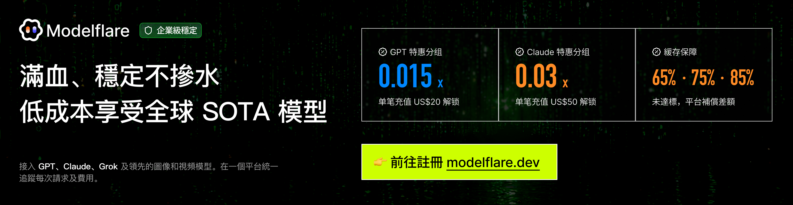
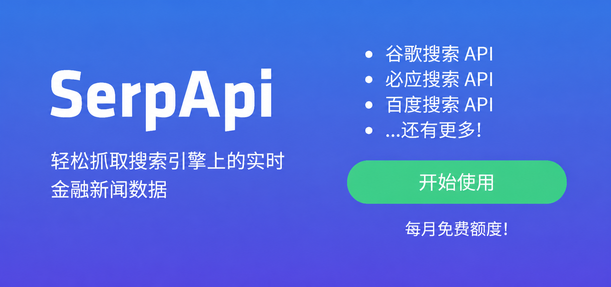

<div align="center">

# 📈 股票智能分析系統 (DSA)

[](https://github.com/ZhuLinsen/daily_stock_analysis/stargazers)
[](https://arxiv.org/abs/2608.26990)
[](https://github.com/ZhuLinsen/daily_stock_analysis/actions/workflows/ci.yml)
[](https://opensource.org/licenses/MIT)
[](https://www.python.org/downloads/)

<p align="center">
  <a href="https://trendshift.io/repositories/18527?utm_source=repository-badge&amp;utm_medium=badge&amp;utm_campaign=badge-repository-18527" target="_blank" rel="noopener noreferrer"></a>&nbsp;
  <a href="https://www.star-history.com/zhulinsen/daily_stock_analysis">
    <picture>
      <source media="(prefers-color-scheme: dark)" srcset="https://api.star-history.com/badge?repo=ZhuLinsen/daily_stock_analysis&amp;type=rank&amp;theme=dark" />
      <source media="(prefers-color-scheme: light)" srcset="https://api.star-history.com/badge?repo=ZhuLinsen/daily_stock_analysis&amp;type=rank" />
      
    </picture>
  </a>
</p>

> 🤖 覆蓋 **A股 / 港股 / 美股 / 日股 / 韓股 / 台股** 的全鏈路 AI 投研工作台：集多源行情聚合、技術/情報分析、Agent 策略問股、決策信號回測驗證、持倉風控與多渠道推送於一體

[**產品預覽**](#-產品預覽) · [**功能特性**](#-功能特性) · [**快速開始**](#-快速開始) · [**推送效果**](#-推送效果) · [**文檔中心**](./INDEX.md) · [**完整指南**](./full-guide.md)

**[下載桌面客戶端](https://github.com/ZhuLinsen/daily_stock_analysis/releases) · [5 分鐘 GitHub Actions](#方式一github-actions推薦) · [Docker / 本地部署](#方式二客戶端配置教程--本地運行--docker-部署)**

繁體中文 | [English](README_EN.md) | [简体中文](../README.md)

</div>

<details>
<summary><strong>💖 贊助商 (Sponsors)：Modelflare · x6.ai · SerpAPI（點擊展開優惠與註冊連結）</strong></summary>
<table>
  <tr><td align="center"><a href="https://modelflare.dev/sign-up?utm_source=github&amp;utm_campaign=daily_stock_analysis"></a><br>感謝 <strong>Modelflare</strong> 贊助本項目！由美國 Havenbyte LLC 營運，滿血穩定不摻水，低成本接入 GPT、Claude、Gemini、Grok 及 40+ 圖片/影片模型。指定 OpenAI 分組提供 <strong>65% / 75% / 85% 每日快取命中率保障</strong>；單筆儲值 <strong>US$20 解鎖 GPT 0.015x</strong>，<strong>US$50 解鎖 Claude 0.03x</strong>。<a href="https://modelflare.dev/sign-up?utm_source=github&amp;utm_campaign=daily_stock_analysis">專屬連結註冊</a></td></tr>
  <tr><td align="center"><a href="https://console.x6pro.io/register?code=zJ2qSdns"></a><br>100+ 模型 $5 包月，Claude 1.9 折、GPT 0.9 折、DeepSeek 5.8 折，首充立減 20%。<a href="https://console.x6pro.io/register?code=zJ2qSdns">專屬連結註冊</a></td></tr>
  <tr><td align="center"><a href="https://serpapi.com/github-daily-stock-analysis" target="_blank"></a></td></tr>
</table>
</details>

## 🖥️ 產品預覽

<p align="center">
  <a href="assets/readme_workspace_tour_20260510.gif"></a><br>
  <sub>點擊動圖查看完整工作台演示（包含分析、選股、決策信號、持倉風控、回測與 Agent 問股）</sub>
</p>

> [!TIP]
> 🚀 **作者配套開源專案**：[AlphaSift · 智能選股](https://github.com/ZhuLinsen/alphasift) ｜ [AlphaEvo · 策略回測與進化](https://github.com/ZhuLinsen/alphaevo)

## ✨ 功能特性

| 階段 | 核心能力與 Web 工作台模組 | 專題文檔 |
|------|------|------|
| **發現** | 多因子與自然語言智能選股（`/screening`）、市場熱點雷達、規則化 ETF 雙動量輪動（`--etf-rotation`） | [選股引擎](./screening-engine.md) · [ETF 輪動](./etf-rotation.md) |
| **分析** | 多市場「決策儀表盤」報告（`/`）、六市場大盤覆盤、15 種內建策略的多輪 Agent 策略問股（`/chat`） | [完整指南](./full-guide.md) · [市場邊界](./market-support.md) |
| **驗證** | 決策信號後驗追蹤池（`/decision-signals`）、多視窗歷史回測（`/backtest`）與 LLM Token 用量審計（`/usage`） | [決策信號](./decision-signals.md) · [回測配置](./full-guide.md#回测功能) |
| **追蹤** | 持倉風險暴露與富途同步（`/portfolio`）、EventMonitor 即時異動告警（`/alerts`）、數據源能力診斷中心（`/data`） | [持倉風控](./portfolio-risk-exposure-dashboard.md) · [告警中心](./alerts.md) · [數據中心](./data-center-diagnostics.md) |
| **觸達與整合** | 視覺化設定中心（`/settings`）、企業微信/飛書/TG/Discord/Slack/郵件推送、長圖分享海報、雙向交互 Bot、REST API 與外部 Agent Skill | [通知配置](./notifications.md) · [Bot 接入](./bot-command.md) · [OpenClaw Skill](./openclaw-skill-integration.md) |

> 專案預設內建 AkShare、Baostock、YFinance 等免費行情源，可零配置執行；如需更穩定的 A股/ETF/港美股行情或新聞檢索，建議配置 [TickPlus](http://www.tickplus.org/register?reg=5433cf922395)、Tushare、Longbridge 或 [SerpAPI](https://serpapi.com/github-daily-stock-analysis)，詳見 [數據源穩定性指南](./data-source-stability.md)。

## 🚀 快速開始

| 上手方式 | 適合人群 | 所需前置 | 入口 |
|------|------|------|------|
| **桌面客戶端** | 不想折騰命令行的個人投資者 | 1 個 AI API Key | [Releases 下載](https://github.com/ZhuLinsen/daily_stock_analysis/releases) · [小白教程](./beginner-client-setup.md) |
| **GitHub Actions** | 零伺服器每日自動分析（推薦） | **僅 1 個 AI 模型 Secret** | [下方 4 步配置](#方式一github-actions推薦) |
| **Docker / 本地 WebUI** | 私有部署、持倉管理與 Agent 問股 | Docker 或 Python 3.10+ | [下方部署命令](#方式二客戶端配置教程--本地運行--docker-部署) · [部署指南](./DEPLOY.md) |

### 方式一：[GitHub Actions（推薦）](https://www.bilibili.com/video/BV11FEb66EXG/)

> 5 分鐘零成本部署：首次跑通**僅需配置 1 個 AI 模型 Secret**；`STOCK_LIST` 預設兜底 `600519`，通知渠道可選（未配通知也可在 Actions Summary 查看運行狀態，或通過 `STEP_SUMMARY_REPORT=true` 開啟報告預覽）。

1. **Fork 本倉庫**：點擊右上角 `Fork`（順便點個 Star ⭐ 支援一下）。
2. **配置至少 1 個 AI 模型 Secret**（`Settings` -> `Secrets and variables` -> `Actions` -> `New repository secret`）：
   - **推薦渠道**：`MODELFLARE_KEY`（[Modelflare](https://modelflare.dev/sign-up?utm_source=github&utm_campaign=daily_stock_analysis)）或 `LLM_X6AI_API_KEY`（[x6.ai](https://console.x6pro.io/register?code=zJ2qSdns)）
   - **官方直連**：`GEMINI_API_KEY`、`ANTHROPIC_API_KEY`、`OPENAI_API_KEY`（兼容 DeepSeek/通義等）、`AIHUBMIX_KEY`
   - **可選增強**：`STOCK_LIST`（如 `600519,hk00700,AAPL,7203.T,005930.KS,2330.TW`）、`SERPAPI_API_KEYS`（新聞補強）、`TICKPLUS_API_KEY`（A股/ETF行情）、通知渠道如 `WECHAT_WEBHOOK_URL` / `FEISHU_WEBHOOK_URL` / `TELEGRAM_BOT_TOKEN`+`TELEGRAM_CHAT_ID`（更多見 [完整指南](./full-guide.md)）。
3. **啟用 Workflows**：進入 Fork 倉庫的 `Actions` 標籤 -> 點擊 `I understand my workflows, go ahead and enable them`。
4. **手動測試**：`Actions` -> `每日股票分析` -> `Run workflow`，之後每個工作日 **18:00（北京時間）** 自動執行（非交易日預設跳過，規則見 [定時任務配置](./full-guide.md#定时任务配置)）。

### 方式二：[客戶端配置教程](https://www.bilibili.com/video/BV11FEb66Eyr/) / 本地運行 / Docker 部署

```bash
# 1. 淺克隆代碼（跳過歷史包袱，更快）
git clone --depth 1 https://github.com/ZhuLinsen/daily_stock_analysis.git && cd daily_stock_analysis

# 2. 安裝依賴並啟動 Web 工作台（推薦直接在網頁設定頁配置模型與自選股）
pip install -r requirements.txt
python main.py --webui-only
```

啟動後訪問 `http://127.0.0.1:8000`（如改用命令行 `.env` 方式，可先執行 `cp .env.example .env` 後運行 `python main.py --doctor` 自檢）。常用 CLI 模式：

```bash
python main.py --doctor                     # 全鏈路脫敏自檢（支援 --json）
python main.py --stocks 600519,hk00700,AAPL # 一次性分析指定標的
python main.py --market-review              # 僅運行大盤覆盤
python main.py --schedule                   # 本地定時排程
python main.py --serve-only                 # 僅啟動 FastAPI + WebUI 服務
```

> Docker 預構建映像、`--etf-rotation` 輪動與雲端伺服器訪問見 [完整指南](./full-guide.md)；桌面端打包見 [桌面端打包說明](./desktop-package.md)；Agent 參數與多模型配置見 [LLM 配置指南](./LLM_CONFIG_GUIDE.md)。

## 📱 推送效果

<details>
<summary>點擊查看文字推送示例（決策儀表盤 &amp; 大盤覆盤）</summary>

```markdown
🎯 2026-02-08 決策儀表盤
共分析3隻股票 | 🟢買入:0 🟡觀望:2 🔴賣出:1
🟡 中鎢高新(000657): 觀望 | 評分 65 | 看多
🚨 風險警報: 主力資金大幅淨賣出，需警惕短期拋壓。
✨ 利好催化: 核心產品放量與業績同比增長支撐基本面。

🎯 2026-01-10 大盤覆盤
📊 主要指數: 上證指數 3250.12 (🟢+0.85%) | 深證成指 10521.36 (🟢+1.02%) | 創業板指 2156.78 (🟢+1.35%)
```

</details>

## 🛠️ 排障與保持更新

- **本地一鍵排障**：運行 `python main.py --doctor` 檢查配置/LLM/通知/儲存狀態；提交 Issue 前請優先升級並附帶脫敏診斷輸出。
- **Fork 保持更新**：定期在 GitHub 頁面點擊 `Sync fork` 同步最新數據源修復；儘量通過 Secrets/Variables 調整參數，避免直接修改 workflow 文件產生衝突。
- **Actions 定時停用**：GitHub 會在倉庫 **60 天無新提交** 後自動暫停定時任務，記得定期 Sync fork 或在 Actions 頁面重新啟用，詳見 [FAQ](./FAQ.md)。

## 📬 聯繫與合作

<table>
  <tr>
    <td width="92" valign="top"><strong>合作郵箱</strong></td>
    <td valign="top"><a href="mailto:zhuls345@gmail.com">zhuls345@gmail.com</a>（項目諮詢、部署支援與功能擴展）</td>
    <td align="center" rowspan="3" valign="middle" width="148">
      <a href="http://xhslink.com/m/tU520DWCKT" target="_blank"></a><br>
      <sub>掃碼關注小紅書</sub>
    </td>
  </tr>
  <tr>
    <td width="92" valign="top"><strong>小紅書</strong></td>
    <td valign="top"><a href="http://xhslink.com/m/tU520DWCKT">歡迎關注小紅書</a></td>
  </tr>
  <tr>
    <td width="92" valign="top"><strong>問題反饋</strong></td>
    <td valign="top"><a href="https://github.com/ZhuLinsen/daily_stock_analysis/issues">提交 Issue</a> · <a href="./INDEX.md">文檔中心</a></td>
  </tr>
</table>

## 📄 License & ⚠️ 免責聲明

[MIT License](../LICENSE) © 2026 ZhuLinsen — 歡迎在二次開發或引用時註明本倉庫來源。本項目僅供學習和研究使用，不構成任何投資建議；股市有風險，投資需謹慎。
