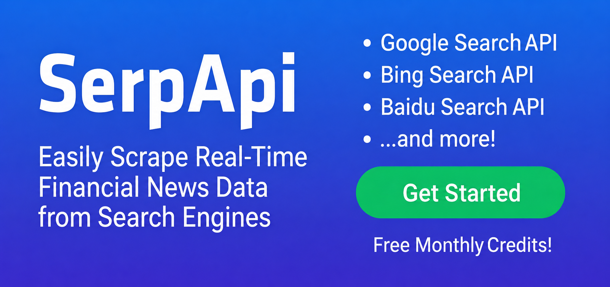

<div align="center">

<a name="ai-stock-analysis-system"></a>

# 📈 AI Stock Analysis System (DSA)

[](https://github.com/ZhuLinsen/daily_stock_analysis/stargazers)
[](https://arxiv.org/abs/2608.26990)
[](https://github.com/ZhuLinsen/daily_stock_analysis/actions/workflows/ci.yml)
[](https://opensource.org/licenses/MIT)
[](https://www.python.org/downloads/)
[](https://github.com/features/actions)
[](https://hub.docker.com/r/zhulinsen/daily_stock_analysis)

<p align="center">
  <a href="https://trendshift.io/repositories/18527?utm_source=repository-badge&amp;utm_medium=badge&amp;utm_campaign=badge-repository-18527" target="_blank" rel="noopener noreferrer"></a>&nbsp;
  <a href="https://www.star-history.com/zhulinsen/daily_stock_analysis">
    <picture>
      <source media="(prefers-color-scheme: dark)" srcset="https://api.star-history.com/badge?repo=ZhuLinsen/daily_stock_analysis&amp;type=rank&amp;theme=dark" />
      <source media="(prefers-color-scheme: light)" srcset="https://api.star-history.com/badge?repo=ZhuLinsen/daily_stock_analysis&amp;type=rank" />
      
    </picture>
  </a>
</p>

> 🤖 AI stock analysis for US, Hong Kong, Japanese, Korean, Taiwanese, and mainland Chinese markets, with decision reports, Agent chat, backtesting, portfolio risk tracking, and notifications.

[**Product Preview**](#-product-preview) · [**Key Features**](#-key-features) · [**Quick Start**](#-quick-start) · [**Sample Output**](#-sample-output) · [**Docs Index**](./INDEX_EN.md)

English | [简体中文](../README.md) | [繁體中文](README_CHT.md)

</div>

## 🚀 Quick Start

<a name="-configuration"></a>

[Full setup guide](./full-guide_EN.md) · [Notification setup](./notifications.md)

| Entry | Best For | Prerequisite | Link |
|-------|----------|--------------|------|
| **GitHub Actions** | Zero-server daily scheduled analysis (Recommended) | **Only 1 AI Model Secret** | [4-Step Setup Below](#option-1-github-actions-recommended) |
| **Local CLI** | Generate a first report or check market data | Git, Python | [3-minute quickstart (Chinese)](./QUICKSTART.md#本地-3-步快速起步) |
| **Docker / Local WebUI** | Self-hosting, portfolio risk & interactive Agent chat | Docker or Git / Python / Node.js | [Commands Below](#option-2-local--docker-deployment) · [Deploy Guide](./DEPLOY_EN.md) |
| **Desktop App** | Personal investors preferring a native GUI | 1 AI API Key | [Releases](https://github.com/ZhuLinsen/daily_stock_analysis/releases) · [Setup Guide](./beginner-client-setup.md) |

### Option 1: GitHub Actions (Recommended)

> GitHub Actions runs the analysis on a hosted runner, and your model provider bills for API usage. Configure **one AI model Secret** to start. `STOCK_LIST` defaults to `600519`, and notifications are optional.

1. <a name="1-fork-this-repository"></a>**Fork this repository**: Click `Fork` in the upper-right corner.
2. <a name="2-configure-secrets"></a>Add one AI key under `Settings` → `Secrets and variables` → `Actions` → `New repository secret`. Choose `MODELFLARE_KEY`, `AIHUBMIX_KEY`, `GEMINI_API_KEY`, `ANTHROPIC_API_KEY`, or official `OPENAI_API_KEY`. See the [model setup table](./full-guide_EN.md#ai-model-configuration-configure-at-least-one) for x6.ai and other compatible endpoints.
3. <a name="3-enable-actions"></a>**Enable Workflows**: Open `Actions` -> click `I understand my workflows, go ahead and enable them`.
4. <a name="done"></a><a name="4-manual-test"></a>**Manual Test & Read Report**: `Actions` -> `每日股票分析` (Daily Stock Analysis workflow) -> `Run workflow`. Check pushed notifications or download the `analysis-reports-*` artifact after completion. Runs every weekday at **18:00 Beijing Time** (skip/resume rules in [Scheduled Task Configuration](./full-guide_EN.md#scheduled-task-configuration)). Enable the manual force-run option if you are testing on a non-trading day.

See the [full guide](./full-guide_EN.md#github-actions-configuration) for watchlist, news, market data, and notification settings.

### Option 2: Local / Docker Deployment

<a name="-web-ui"></a>

Local WebUI requires Git, Python 3.10+, Node.js `^20.19.0 || ^22.12.0 || >=24.0.0 <27`, and npm 10+.

The official OpenAI preset (`OpenAI 官方`) defaults to `gpt-6.1-sol` over Chat Completions. Use Python 3.11+ and replace the dependency install command below with `python -m pip install -r requirements.txt "litellm>=1.98.1"`. On Python 3.10, use `gpt-5` in the preset's model list if your account has access, then test the connection.

```bash
git clone --depth 1 https://github.com/ZhuLinsen/daily_stock_analysis.git
cd daily_stock_analysis
python -m pip install -r requirements.txt
(cd apps/dsa-web && npm ci && npm run build)
python main.py --serve-only
```

Open `http://127.0.0.1:8000` and enter your AI key and watchlist in Settings to start an analysis. For Docker, follow the [deployment guide](./DEPLOY_EN.md).

## ✨ Key Features

| Stage | Core Capabilities & Web Workspace Modules | Docs |
|-------|-------------------------------------------|------|
| **Discover** | Multi-factor & natural-language stock screening (`/screening`), market hotspots, rule-based dual-momentum ETF rotation (`--etf-rotation`) | [Screening Engine](./screening-engine.md) · [ETF Rotation](./etf-rotation.md) |
| **Analyze** | 6-market Decision Dashboard (`/`), market review, multi-turn Agent strategy chat with 15 built-in strategies (`/chat`) | [Full Guide](./full-guide_EN.md) · [Market Boundaries](./market-support.md) |
| **Verify** | Decision signal pool (`/decision-signals`), win-rate backtest (`/backtest`), data-source diagnostics & run observability | [Decision Signals](./decision-signals.md) · [Data Center](./data-center-diagnostics.md) |
| **Track** | Portfolio ledger & risk exposure (`/portfolio` with CSV import; read-only Futu holdings selection via CLI `--portfolio futu`), real-time alerts (`/alerts`), token usage (`/usage`) | [Portfolio Risk](./portfolio-risk-exposure-dashboard.md) · [Alerts](./alerts.md) |
| **Deliver** | Zero-server GitHub Actions schedule, Electron desktop app, Telegram / Discord / Slack / Email / ntfy / Gotify / WeChat / Feishu notifications | [Notifications](./notifications.md) · [Bot Commands](./bot-command_EN.md) |

<a name="-agent-strategy-chat"></a>

Use [Agent strategy chat](./full-guide_EN.md#local-webui-management-interface) in the Web or desktop workspace.

### 🖥️ Product Preview

<p align="center">
  <a href="assets/readme_workspace_tour_20260510.gif"></a><br>
  <sub>Click the GIF to view the full demo (analysis, screening, decision signals, portfolio risk, backtest &amp; Agent chat)</sub>
</p>

> [!TIP]
> 🚀 **Ecosystem Projects**: [AlphaSift · Smart screening](https://github.com/ZhuLinsen/alphasift) | [AlphaEvo · Strategy backtesting & evolution](https://github.com/ZhuLinsen/alphaevo)

### 📱 Sample Output

<a name="decision-dashboard"></a>
<a name="market-review"></a>

<details>
<summary>Click to expand sample outputs (Decision Dashboard &amp; Market Review)</summary>

```markdown
🎯 2026-02-08 Decision Dashboard
Analyzed 3 stocks | 🟢 Buy:0 🟡 Watch:2 🔴 Sell:1
🟡 000657: Watch | Score 65 | Bullish
🟡 600105: Watch | Score 48 | Range-bound
🔴 300260: Sell | Score 35 | Bearish
🚨 Risk Alerts: Main-force funds showed notable outflow. Chip concentration suggests short-term resistance.
✨ Positive Catalysts: AI-server supply-chain exposure and recent earnings growth support fundamentals.

🎯 2026-01-10 Market Review
📊 Major Indices: SSE Composite 3250.12 (🟢+0.85%) | SZSE Component 10521.36 (🟢+1.02%) | ChiNext 2156.78 (🟢+1.35%)
📈 Market Breadth: Up 3920 | Down 1349 | Limit up 155 | Limit down 3
```

</details>

### Tech Stack & Data Sources

| Type | Supported |
|------|-----------|
| **Application** | Python / FastAPI, React / Vite, Electron |
| **AI Models** | [Modelflare](https://modelflare.dev/sign-up?utm_source=github&utm_campaign=daily_stock_analysis), [x6.ai](https://console.x6pro.io/register?code=zJ2qSdns), AIHubMix, Gemini, OpenAI-compatible providers, DeepSeek, Qwen, Claude, Ollama |
| **Market Data** | YFinance, Longbridge, AkShare, Tushare, [TickPlus](http://www.tickplus.org/register?reg=5433cf922395), Pytdx, Baostock (works out-of-the-box with free sources across US/HK/JP/KR/TW/CN, with optional token-based sources) |
| **News & Sentiment** | [SerpAPI](https://serpapi.com/github-daily-stock-analysis), Tavily, Brave, Anspire, Bocha, MiniMax, SearXNG. Optional Stock Sentiment API (Reddit / X / Polymarket for US tickers) |

**[3-minute quickstart (Chinese)](./QUICKSTART.md) · [GitHub Actions](#option-1-github-actions-recommended) · [Docker / Local WebUI](#option-2-local--docker-deployment) · [Download Desktop App](https://github.com/ZhuLinsen/daily_stock_analysis/releases)**

<details open>
<summary><strong>💖 Sponsors</strong></summary>
<table>
  <tr><td align="center"><a href="https://modelflare.dev/sign-up?utm_source=github&amp;utm_campaign=daily_stock_analysis"></a><br>Thanks to <strong>Modelflare</strong> for sponsoring this project! Operated by US-based Havenbyte LLC, it offers full-strength, stable GPT, Claude, Gemini, Grok and 40+ image/video models at lower cost. Selected OpenAI groups offer <strong>65% / 75% / 85% daily cache-hit guarantees</strong>; a single <strong>US$20 top-up unlocks GPT at 0.015x</strong>, and <strong>US$50 unlocks Claude at 0.03x</strong>. <a href="https://modelflare.dev/sign-up?utm_source=github&amp;utm_campaign=daily_stock_analysis">Register via this exclusive link</a></td></tr>
  <tr><td align="center"><a href="https://console.x6pro.io/register?code=zJ2qSdns"></a><br>100+ models from $5/month. Claude 81% off, GPT 91% off, DeepSeek 42% off, plus 20% off your first top-up. <a href="https://console.x6pro.io/register?code=zJ2qSdns">Register</a></td></tr>
  <tr><td align="center"><a href="https://serpapi.com/github-daily-stock-analysis" target="_blank"></a></td></tr>
</table>
</details>

## 📞 Contact

<table>
  <tr>
    <td width="92" valign="top"><strong>Email</strong></td>
    <td valign="top">
      <a href="mailto:zhuls345@gmail.com">zhuls345@gmail.com</a><br>
      Project consulting, deployment support, and feature extensions
    </td>
    <td align="center" rowspan="3" valign="middle" width="148">
      <a href="http://xhslink.com/m/tU520DWCKT" target="_blank"></a><br>
      <sub>Follow on Xiaohongshu</sub>
    </td>
  </tr>
  <tr>
    <td width="92" valign="top"><strong>Xiaohongshu</strong></td>
    <td valign="top"><a href="http://xhslink.com/m/tU520DWCKT">Follow on Xiaohongshu</a></td>
  </tr>
  <tr>
    <td width="92" valign="top"><strong>Feedback</strong></td>
    <td valign="top"><a href="https://github.com/ZhuLinsen/daily_stock_analysis/issues">GitHub Issues</a> · <a href="https://github.com/ZhuLinsen/daily_stock_analysis/discussions">Discussions</a></td>
  </tr>
</table>

## 📄 License

[MIT License](../LICENSE) © 2026 ZhuLinsen

If you use or build on this project, attribution with a link back to this repository is appreciated.

## ⚠️ Disclaimer

This project is for informational and educational purposes only. AI-generated analysis is not investment advice. Stock market investing involves risk; do your own research and consult a licensed financial advisor when needed.
