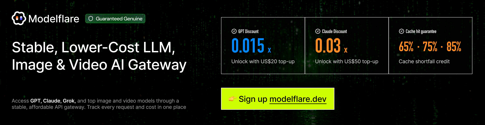

<div align="center">

# 📈 AI Stock Analysis System (DSA)

[](https://github.com/ZhuLinsen/daily_stock_analysis/stargazers)
[](https://arxiv.org/abs/2608.26990)
[](https://github.com/ZhuLinsen/daily_stock_analysis/actions/workflows/ci.yml)
[](https://opensource.org/licenses/MIT)
[](https://www.python.org/downloads/)
[](https://github.com/features/actions)
[](https://hub.docker.com/r/zhulinsen/daily_stock_analysis)

<p align="center">
  <a href="https://trendshift.io/repositories/18527?utm_source=repository-badge&amp;utm_medium=badge&amp;utm_campaign=badge-repository-18527" target="_blank" rel="noopener noreferrer"></a>&nbsp;
  <a href="https://www.star-history.com/zhulinsen/daily_stock_analysis">
    <picture>
      <source media="(prefers-color-scheme: dark)" srcset="https://api.star-history.com/badge?repo=ZhuLinsen/daily_stock_analysis&amp;type=rank&amp;theme=dark" />
      <source media="(prefers-color-scheme: light)" srcset="https://api.star-history.com/badge?repo=ZhuLinsen/daily_stock_analysis&amp;type=rank" />
      
    </picture>
  </a>
</p>

> 🤖 **6-Market AI Equity Research Agent & Dashboard** (**US / HK / JP / KR / TW / CN**): multi-source market data, technical & intel analysis, 15-strategy Agent Q&A, signal backtesting, portfolio risk tracking, and read-only **MCP Server**

[**Product Preview**](#-product-preview) · [**Key Features**](#-key-features) · [**Quick Start**](#-quick-start) · [**MCP Server**](#-mcp-server-for-claude-code--cursor) · [**Sample Output**](#-sample-output) · [**Docs Index**](./INDEX_EN.md)

**[5-Min GitHub Actions](#option-1-github-actions-recommended) · [Docker / Local WebUI](#option-2-local--docker-deployment) · [Download Desktop App](https://github.com/ZhuLinsen/daily_stock_analysis/releases)**

English | [简体中文](../README.md) | [繁體中文](README_CHT.md)

</div>

<details open>
<summary><strong>💖 Sponsors</strong></summary>
<table>
  <tr><td align="center"><a href="https://modelflare.dev/sign-up?utm_source=github&amp;utm_campaign=daily_stock_analysis"></a><br>Thanks to <strong>Modelflare</strong> for sponsoring this project! Operated by US-based Havenbyte LLC, it offers full-strength, stable GPT, Claude, Gemini, Grok and 40+ image/video models at lower cost. Selected OpenAI groups offer <strong>65% / 75% / 85% daily cache-hit guarantees</strong>; a single <strong>US$20 top-up unlocks GPT at 0.015x</strong>, and <strong>US$50 unlocks Claude at 0.03x</strong>. <a href="https://modelflare.dev/sign-up?utm_source=github&amp;utm_campaign=daily_stock_analysis">Register via this exclusive link</a></td></tr>
  <tr><td align="center"><a href="https://console.x6pro.io/register?code=zJ2qSdns"></a><br>100+ models from $5/month. Claude 81% off, GPT 91% off, DeepSeek 42% off, plus 20% off your first top-up. <a href="https://console.x6pro.io/register?code=zJ2qSdns">Register</a></td></tr>
  <tr><td align="center"><a href="https://serpapi.com/github-daily-stock-analysis" target="_blank"></a></td></tr>
</table>
</details>

## 💻 Product Preview

<p align="center">
  <a href="assets/readme_workspace_tour_20260510.gif"></a><br>
  <sub>Click the GIF to view the full demo (analysis, screening, decision signals, portfolio risk, backtest &amp; Agent chat)</sub>
</p>

> [!TIP]
> 🚀 **Ecosystem Projects**: [AlphaSift · Smart screening](https://github.com/ZhuLinsen/alphasift) | [AlphaEvo · Strategy backtesting & evolution](https://github.com/ZhuLinsen/alphaevo)

## ✨ Key Features

| Stage | Core Capabilities & Web Workspace Modules | Docs |
|-------|-------------------------------------------|------|
| **Discover** | Multi-factor & natural-language stock screening (`/screening`), market hotspots, rule-based dual-momentum ETF rotation (`--etf-rotation`) | [Screening Engine](./screening-engine.md) · [ETF Rotation](./etf-rotation.md) |
| **Analyze** | 6-market Decision Dashboard (`/`), market review, multi-turn Agent strategy chat with 15 built-in strategies (`/chat`) | [Full Guide](./full-guide_EN.md) · [Market Boundaries](./market-support.md) |
| **Verify** | Decision signal pool (`/decision-signals`), win-rate backtest (`/backtest`), data-source diagnostics & run observability | [Decision Signals](./decision-signals.md) · [Data Center](./data-center-diagnostics.md) |
| **Track** | Portfolio ledger & risk exposure (`/portfolio`, Futu sync), real-time alerts (`/alerts`), token usage (`/usage`) | [Portfolio Risk](./portfolio-risk-exposure-dashboard.md) · [Alerts](./alerts.md) |
| **Deliver** | Zero-server GitHub Actions schedule, Electron desktop app, Telegram / Discord / Slack / Email / ntfy / Gotify / WeChat / Feishu notifications | [Notifications](./notifications.md) · [Bot Commands](./bot-command_EN.md) |

### Tech Stack & Data Sources

| Type | Supported |
|------|-----------|
| **AI Models** | [Modelflare](https://modelflare.dev/sign-up?utm_source=github&utm_campaign=daily_stock_analysis), [x6.ai](https://console.x6pro.io/register?code=zJ2qSdns), AIHubMix, Gemini, OpenAI-compatible providers, DeepSeek, Qwen, Claude, Ollama |
| **Market Data** | YFinance, Longbridge, AkShare, Tushare, [TickPlus](http://www.tickplus.org/register?reg=5433cf922395), Pytdx, Baostock (works out-of-the-box with free sources across US/HK/JP/KR/TW/CN; token sources optional for heavy batches) |
| **News & Sentiment** | [SerpAPI](https://serpapi.com/github-daily-stock-analysis), Tavily, Brave, Anspire, Bocha, MiniMax, SearXNG; optional Stock Sentiment API (Reddit / X / Polymarket for US tickers) |

## 🚀 Quick Start

| Entry | Best For | Prerequisite | Link |
|-------|----------|--------------|------|
| **GitHub Actions** | Zero-server daily scheduled analysis (Recommended) | **Only 1 AI Model Secret** | [4-Step Setup Below](#option-1-github-actions-recommended) |
| **Docker / Local WebUI** | Self-hosting, portfolio risk & interactive Agent chat | Docker or Python 3.10+ | [Commands Below](#option-2-local--docker-deployment) · [Deploy Guide](./DEPLOY_EN.md) |
| **MCP Server (Stdio)** | Exposing 6-market data & reports to Claude Code / Cursor | Python 3.10+ | [MCP Setup Below](#-mcp-server-for-claude-code--cursor) |
| **Desktop App** | Personal investors preferring a native GUI | 1 AI API Key | [Releases](https://github.com/ZhuLinsen/daily_stock_analysis/releases) · [Setup Guide](./beginner-client-setup.md) |

### Option 1: GitHub Actions (Recommended)

> Deploy in ~5 minutes with **zero server cost** (LLM API usage is billed by your provider). Only **1 AI model Secret** is needed; `STOCK_LIST` defaults to `600519` (override with e.g. `AAPL,NVDA,hk00700,7203.T,005930.KS,2330.TW`), and notification webhooks are optional.

1. **Fork this repository**: Click `Fork` in the upper-right corner (a star is always appreciated!).
2. **Add at least 1 AI model Secret** (`Settings` -> `Secrets and variables` -> `Actions` -> `New repository secret`):
   - **1-Secret setup (ready out-of-the-box)**: `MODELFLARE_KEY` ([Modelflare](https://modelflare.dev/sign-up?utm_source=github&utm_campaign=daily_stock_analysis), auto-configures default base URL & model), `AIHUBMIX_KEY`, `GEMINI_API_KEY`, `ANTHROPIC_API_KEY`, or official `OPENAI_API_KEY`
   - **Multi-variable channels / custom endpoints**: For [x6.ai](https://console.x6pro.io/register?code=zJ2qSdns), configure `LLM_CHANNELS=x6ai`, `LLM_X6AI_BASE_URL`, `LLM_X6AI_API_KEY`, and `LLM_X6AI_MODELS` (see [x6.ai channel example](./llm-providers.md#x6ai-聚合平台)); for OpenAI-compatible DeepSeek/Qwen, set `OPENAI_API_KEY` + `OPENAI_BASE_URL` + `OPENAI_MODEL`
   - **Optional extras**: `STOCK_LIST` (e.g. `AAPL,NVDA,hk00700,7203.T,005930.KS,2330.TW,600519`; see [Index Watchlist](./full-guide_EN.md#index-watchlist-configuration)), `SERPAPI_API_KEYS` / `TAVILY_API_KEYS` (news), `LONGBRIDGE_OAUTH_CLIENT_ID` / `TUSHARE_TOKEN` / `TICKPLUS_API_KEY` (market data), and notification webhooks (`TELEGRAM_BOT_TOKEN`+`TELEGRAM_CHAT_ID`, `DISCORD_WEBHOOK_URL`, `SLACK_BOT_TOKEN`+`SLACK_CHANNEL_ID`, `EMAIL_SENDER`+`EMAIL_PASSWORD`, `NTFY_URL`, `GOTIFY_URL`+`GOTIFY_TOKEN`, `FEISHU_WEBHOOK_URL`, `WECHAT_WEBHOOK_URL`; see [Full Guide](./full-guide_EN.md)).
3. **Enable Workflows**: Open `Actions` -> click `I understand my workflows, go ahead and enable them`.
4. **Manual Test & Read Report**: `Actions` -> `每日股票分析` (Daily Stock Analysis workflow) -> `Run workflow`. Check pushed notifications or download the `analysis-reports-*` artifact after completion. Runs every weekday at **18:00 Beijing Time** (skip/resume rules in [Scheduled Task Configuration](./full-guide_EN.md#scheduled-task-configuration)).

### Option 2: Local / Docker Deployment

```bash
# 1. Shallow clone for faster download
git clone --depth 1 https://github.com/ZhuLinsen/daily_stock_analysis.git && cd daily_stock_analysis

# 2. Install dependencies and launch the Web workspace (configure keys & watchlist directly in Settings)
pip install -r requirements.txt
python main.py --webui-only
```

Open `http://127.0.0.1:8000` in your browser (preview the built-in sample report immediately, or run live analysis after saving a key). For CLI / `.env` workflows:

```bash
cp .env.example .env && vim .env
python main.py                               # Full analysis (stocks + market review)
python main.py --stocks AAPL,hk00700,2330.TW # One-shot analysis for specific tickers
python main.py --market-review               # Market review only
python main.py --schedule                    # Local scheduler
python main.py --serve-only                  # FastAPI + WebUI only
```

> Docker deployment, cloud WebUI access, and `--etf-rotation` are in the [Full Guide](./full-guide_EN.md); multi-model routing and Agent flags are in the [LLM Config Guide](./LLM_CONFIG_GUIDE_EN.md).

## 🔌 MCP Server (for Claude Code / Cursor)

Expose DSA's 6-market quotes, daily history, technical analysis, news search, and persisted reports directly to Claude Code, Cursor, or any MCP-compatible client over stdio (stdlib JSON-RPC 2.0, zero extra dependencies, read-only with secrets redacted and portfolio tools disabled):

```bash
claude mcp add dsa -- python -m src.mcp_server
# Optional flags: "--include-macro" (FX/macro read-only) or "--enable-paper-trading" (sandbox with hard stop-loss & 25% cap).
```


## 📱 Sample Output

<details>
<summary>Click to expand sample outputs (Decision Dashboard &amp; Market Review)</summary>

```markdown
🎯 2026-02-08 Decision Dashboard
Analyzed 3 stocks | 🟢 Buy:0 🟡 Watch:2 🔴 Sell:1
🟡 000657: Watch | Score 65 | Bullish
🟡 600105: Watch | Score 48 | Range-bound
🔴 300260: Sell | Score 35 | Bearish
🚨 Risk Alerts: Main-force funds showed notable outflow; chip concentration suggests short-term resistance.
✨ Positive Catalysts: AI-server supply-chain exposure and recent earnings growth support fundamentals.

🎯 2026-01-10 Market Review
📊 Major Indices: SSE Composite 3250.12 (🟢+0.85%) | SZSE Component 10521.36 (🟢+1.02%) | ChiNext 2156.78 (🟢+1.35%)
📈 Market Breadth: Up 3920 | Down 1349 | Limit up 155 | Limit down 3
```

</details>

## 🛠️ Troubleshooting & Keeping Updated

- **Syncing your fork**: Click `Sync fork` on GitHub regularly for upstream data-source and model fixes; avoid editing workflow YAML directly so syncs stay conflict-free.
- **60-day schedule pause**: GitHub pauses scheduled workflows in repositories with **no repository activity for 60 days**—re-enable under `Actions` or sync your fork. See [FAQ](./FAQ_EN.md).

## 📞 Contact

<table>
  <tr>
    <td width="92" valign="top"><strong>Email</strong></td>
    <td valign="top"><a href="mailto:zhuls345@gmail.com">zhuls345@gmail.com</a> (Consulting, deployment support &amp; custom extensions)</td>
    <td align="center" rowspan="3" valign="middle" width="148">
      <a href="http://xhslink.com/m/tU520DWCKT" target="_blank"></a><br>
      <sub>Follow on Xiaohongshu</sub>
    </td>
  </tr>
  <tr>
    <td width="92" valign="top"><strong>Xiaohongshu</strong></td>
    <td valign="top"><a href="http://xhslink.com/m/tU520DWCKT">Follow on Xiaohongshu</a></td>
  </tr>
  <tr>
    <td width="92" valign="top"><strong>Feedback</strong></td>
    <td valign="top"><a href="https://github.com/ZhuLinsen/daily_stock_analysis/issues">GitHub Issues</a> · <a href="./INDEX_EN.md">Documentation Index</a></td>
  </tr>
</table>

## 📄 License & ⚠️ Disclaimer

[MIT License](../LICENSE) © 2026 ZhuLinsen — Attribution with a link back to this repository is appreciated. This project is for informational and educational purposes only and is not investment advice; stock investing involves risk.
